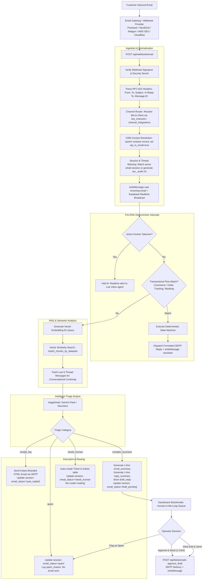

# Email Reply Bot & Intelligent Triage System — Architecture & UI Specification

> **Platform:** Vittain AI / RAG-Widget Omnichannel Engine  
> **Module:** Intelligent Inbound Email Triage, Human-in-the-Loop Review & Outbound Auto-Reply  
> **Status:** Production Implemented & Active  
> **Core Implementation Files:**
> - Engine & Triage: [`src/lib/emailTriage.ts`](file:///Users/arsotoxic/Documents/final/rag-widget/src/lib/emailTriage.ts)
> - Webhook Pipeline: [`src/app/api/webhook/email/route.ts`](file:///Users/arsotoxic/Documents/final/rag-widget/src/app/api/webhook/email/route.ts)
> - Dispatch API: [`src/app/api/bots/emails/route.ts`](file:///Users/arsotoxic/Documents/final/rag-widget/src/app/api/bots/emails/route.ts)
> - SMTP & Template Engine: [`src/lib/email.ts`](file:///Users/arsotoxic/Documents/final/rag-widget/src/lib/email.ts)
> - UI Dashboard: [`src/app/(dashboard)/bots/emails/page.tsx`](file:///Users/arsotoxic/Documents/final/rag-widget/src/app/(dashboard)/bots/emails/page.tsx)
> - Schema Migration: [`supabase/040_email_triage.sql`](file:///Users/arsotoxic/Documents/final/rag-widget/supabase/040_email_triage.sql)

---

## 1. Executive Summary & Core Philosophy

The **Email Reply Bot** is an enterprise-grade omnichannel module built to handle customer emails with the precision of a seasoned support and sales team. 

Unlike website chat widgets—where visitors expect instant, short, back-and-forth snippets—**email communication is inherently asynchronous, structured, and high-stakes**:
1. **Zero Hallucination Tolerance:** Sending an inaccurate AI hallucination via email can bind a business to incorrect pricing, non-existent contractual commitments, or false SLA promises.
2. **Context Asymmetry:** Inbound emails often contain complex, multi-paragraph background, forwarded chains, and high-value RFQs (Requests for Quote).
3. **The Dual-Tier Solution:** Rather than naively auto-replying to every email or dumping everything into an overwhelming unread inbox, the system implements a **Dual-Tier Hybrid Triage Architecture**:
   - **Routine, deterministic FAQs** are answered instantly with beautiful, branded HTML emails.
   - **Complex, high-value business inquiries** trigger the **Human-in-the-Loop Copilot**: the AI researches the client's vector knowledge base, formulates an executive draft response, summarizes both the customer's request and the proposed response into **scannable 1-liners**, and places it into an operator queue for **1-click approval or edit**.
   - **Spam, bounces, and phishing** are quarantined automatically with human auditability.
   - **Out-of-coverage queries** auto-generate support tickets and escalate to human operators.

---

## 2. End-to-End System Architecture



---

## 3. The 4-Category Triage Engine

Implemented in [`src/lib/emailTriage.ts`](file:///Users/arsotoxic/Documents/final/rag-widget/src/lib/emailTriage.ts). The engine uses a two-phase architecture: fast deterministic pre-filtering followed by an LLM reasoning prompt.

### Phase 1: Fast Heuristic Pre-Filter
Before executing LLM tokens, obvious automated noise is filtered out:
- Senders matching `mailer-daemon`, `postmaster@`
- Subjects starting with `undelivered mail`, `delivery status notification (failure)`
- Bulk email indicators (`unsubscribe from this list`, common spam triggers)

### Phase 2: Cognitive Triage Matrix

| Category | Definition | Knowledge Base Coverage | AI Action | Outcome / Status |
| :--- | :--- | :--- | :--- | :--- |
| **`spam`** | Automated bounces, marketing blasts, phishing, irrelevant spam. | N/A | Generates short `spam_reason`. Suppresses auto-replies. | `email_status = 'spam'`<br/>Quarantined in Spam tab. |
| **`simple_faq`** | Standard, routine inquiries (operating hours, return window, standard shipping pricing). | High confidence; complete coverage in chunks. | Generates clear, courteous, direct `auto_reply`. | `email_status = 'auto_replied'`<br/>Outbound HTML email sent immediately via SMTP. |
| **`complex_business`** | High-value, custom enterprise, bulk order, partnership, contractual terms, multi-step migrations. | Relevant context exists in chunks to formulate an answer. | Generates:<br/>1. `email_summary` (1-liner)<br/>2. `reply_summary` (1-liner)<br/>3. `draft_reply` (full executive email) | `email_status = 'draft_pending'`<br/>**Requires Human 1-Click Approval**. |
| **`needs_human`** | Legitimate customer issue with zero or insufficient knowledge base coverage (e.g. bug investigation, refund dispute). | Low confidence or missing documentation. | Summarizes request in `email_summary`. Leaves `draft_reply` empty. | `email_status = 'needs_human'`<br/>Auto-creates support ticket. Opens manual composer. |

---

## 4. Database Schema & State Model

Applied via [`supabase/040_email_triage.sql`](file:///Users/arsotoxic/Documents/final/rag-widget/supabase/040_email_triage.sql) extending the existing `sessions` entity:

```sql
-- Extended email triage columns on public.sessions
ALTER TABLE public.sessions 
  ADD COLUMN IF NOT EXISTS email_status TEXT,   -- 'draft_pending' | 'auto_replied' | 'needs_human' | 'spam'
  ADD COLUMN IF NOT EXISTS email_subject TEXT,  -- Email subject line
  ADD COLUMN IF NOT EXISTS email_summary TEXT,  -- 1-line customer email summary (Blue card)
  ADD COLUMN IF NOT EXISTS reply_summary TEXT,  -- 1-line proposed reply summary (Green card)
  ADD COLUMN IF NOT EXISTS draft_reply TEXT,    -- Full draft reply awaiting human approval
  ADD COLUMN IF NOT EXISTS spam_reason TEXT;    -- Reason assigned by triage classifier

-- Optimized indexes for sub-millisecond filtering across thousands of threads
CREATE INDEX IF NOT EXISTS idx_sessions_email_status ON public.sessions(email_status);
CREATE INDEX IF NOT EXISTS idx_sessions_channel_email ON public.sessions(channel) WHERE channel = 'email';
```

### Relational Entity Mapping:
- **`clients`** (1) ── (N) **`bots`**: Client owns multiple bots (e.g., Sales Bot on WhatsApp vs Support Bot on Email).
- **`bots`** (1) ── (N) **`bot_channels`**: Stores email channel identity (`identifier: support@brand.com`) and SMTP/IMAP credentials.
- **`contacts`**: Unified customer profile across channels (`email`, `phone`, `opt_in_email: true`).
- **`sessions`**: Email conversation thread, identified by `em_<sender>_<hash>` session key.
- **`messages`**: Chronological email exchanges preserving RFC-2822 metadata (`In-Reply-To`, `References`).
- **`tickets`**: Auto-spawned support ticket when status is `needs_human`.

---

## 5. UI Structure & Operator Experience

The Email Operations center is located at `/bots/emails` ([`src/app/(dashboard)/bots/emails/page.tsx`](file:///Users/arsotoxic/Documents/final/rag-widget/src/app/(dashboard)/bots/emails/page.tsx)).

### 5.1. Visual Layout Hierarchy

```
┌────────────────────────────────────────────────────────────────────────────────────────┐
│  PAGE HEADER                                                                           │
│  Emails & AI Operations                                                                │
│  "Review AI-classified customer emails, 1-click approve drafts, and manage triage."    │
├────────────────────────────────────────────────────────────────────────────────────────┤
│  STATUS TABS (with real-time counts & color-coded badges)                               │
│  [ Pending Approval (3) ]  [ Needs Human (1) ]  [ Auto-Replied (18) ]  [ Spam (4) ]     │
├────────────────────────────────────────────────────────────────────────────────────────┤
│  SEARCH & TOOLBAR                                                                      │
│  [ 🔍 Search by subject, customer name, email, or AI summary... ]                      │
├────────────────────────────────────────────────────────────────────────────────────────┤
│  CONVERSATION CARD (Example: Pending Approval)                                         │
│  ┌──────────────────────────────────────────────────────────────────────────────────┐  │
│  │ 👤 Sarah Jenkins <sarah@enterprise.co>   Subject: Custom Enterprise SLA & Pricing │  │
│  │    Received: Today, 10:42 AM  •  Bot: Enterprise Sales Bot  •  [ Pending Approval ]│  │
│  ├──────────────────────────────────────────────────────────────────────────────────┤  │
│  │  ┌─────────────────────────────────────┐  ┌───────────────────────────────────┐  │  │
│  │  │ 📧 CUSTOMER REQUEST (1-LINER)       │  │ ✨ PROPOSED REPLY (1-LINER)       │  │  │
│  │  │ Inquiring about 100-seat volume     │  │ Quoted Enterprise Tier at $79/seat│  │  │
│  │  │ discount, custom SLA, and SSO.      │  │ with 99.9% SLA and setup call.    │  │  │
│  │  └─────────────────────────────────────┘  └───────────────────────────────────┘  │  │
│  ├──────────────────────────────────────────────────────────────────────────────────┤  │
│  │  PROPOSED EMAIL DRAFT FOR REVIEW                         [ ✏️ Edit Draft ]        │  │
│  │  ┌────────────────────────────────────────────────────────────────────────────┐  │  │
│  │  │ Hi Sarah,                                                                  │  │  │
│  │  │                                                                            │  │  │
│  │  │ Thank you for reaching out regarding our Enterprise tier. For 100 seats,   │  │  │
│  │  │ we provide dedicated SSO integration, custom security review, and a 99.9%  │  │  │
│  │  │ uptime SLA. Our volume rate is $79/seat/month.                             │  │  │
│  │  │                                                                            │  │  │
│  │  │ Would you be open to a 15-minute call this Thursday to finalize the setup? │  │  │
│  │  │                                                                            │  │  │
│  │  │ Best regards,                                                              │  │  │
│  │  │ Enterprise Support Team                                                    │  │  │
│  │  └────────────────────────────────────────────────────────────────────────────┘  │  │
│  │  [  Approve & Send Email (1-Click)  ]   [ Mark as Spam ]   [ View Full Thread ▾ ]│  │
│  └──────────────────────────────────────────────────────────────────────────────────┘  │
└────────────────────────────────────────────────────────────────────────────────────────┘
```

### 5.2. Core UI Components

1. **Top Metric Tabs:**
   - **`Pending Approval`** (Amber badge): Highlights complex business emails where the AI draft is waiting for human dispatch.
   - **`Needs Human`** (Blue badge): Inquiries outside knowledge base coverage requiring manual answer formulation.
   - **`Auto-Replied`** (Emerald badge): Complete historical log of emails resolved automatically by the AI FAQ engine.
   - **`Spam`** (Rose badge): Quarantined automated emails with classification justification.
   - **`All`**: Complete chronological inbox.

2. **The "Dual 1-Liner" Cards:**
   - **Customer Request 1-Liner (Blue Banner):** Provides instant cognitive comprehension in under 2 seconds. Operators never have to read a 500-word rambling email just to understand the ask.
   - **Proposed Reply 1-Liner (Emerald Banner):** Tells the operator what the AI is offering (e.g. discount percentage, policy clause quoted) before they even read the draft.

3. **Interactive Action Controls:**
   - **`Approve & Send Email` (Emerald Button):** 1-click dispatch. Resolves credentials, sends through SMTP, logs the message, updates the thread, and optimistically transitions the card.
   - **`Edit Draft` Toggle:** Transitions the draft preview into a live textarea with auto-height for on-the-fly tweaking.
   - **`Manual Support Composer` (Needs Human Tab):** Provides an inline composition textarea directly on the card so agents can respond without switching applications.
   - **`Not Spam (Restore)`:** Allows 1-click reclassification if an email was flagged incorrectly.
   - **`Thread History Drawer`:** Expands an accordion containing full prior exchanges between customer and bot.

---

## 6. Email Delivery & Outbound Formatting System

Implemented in [`src/lib/email.ts`](file:///Users/arsotoxic/Documents/final/rag-widget/src/lib/email.ts).

### 6.1. Credential Resolution Hierarchy
The system dynamically resolves the sending SMTP server with zero hardcoding:
1. **Bot-level credentials:** Queries `bot_channels` where `channel_type = 'email'` for the target `bot_id`.
2. **Client-level integrations:** Queries `channel_integrations` for active `email` config belonging to `client_id`.
3. **Platform Environment Fallback:** Uses platform-wide `SMTP_HOST`, `SMTP_USER`, `SMTP_PASS` if individual bot credentials are not configured.

### 6.2. RFC-2822 Threading Headers
To ensure outbound replies nest perfectly inside the customer's Gmail, Outlook, or Apple Mail thread, every outgoing message includes:
- `In-Reply-To: <original_message_id>`
- `References: <original_message_id>`
- `Subject: Re: <original_subject>`

### 6.3. Responsive HTML Layout
Every outgoing email is rendered inside a responsive, high-deliverability HTML email template featuring:
- Clean `-apple-system` sans-serif typography.
- Client branding header.
- Paragraph spacing and mobile-first width constraints (max 600px).
- Legally compliant footer stating the support channel context and reply continuity.

---

## 7. Security, Guardrails & Reliability

1. **Loop Protection (Infinite Bounce Prevention):**
   - Heuristic rejection of `mailer-daemon` and `postmaster` addresses.
   - Session threading prevents AI from replying to its own messages.
2. **Webhook Authorization:**
   - Inbound webhook endpoint validates `EMAIL_WEBHOOK_SECRET` header or query token to prevent spoofed inbound traffic.
3. **Atomic State Updates:**
   - Inbound customer emails and outbound AI replies are committed via `writeMessage()`.
   - Redis CAS locks prevent dual concurrent processing of identical webhook retries.
   - Realtime Supabase broadcast instantly syncs the Live Inbox so agents see customer messages without manual refresh.
4. **CRM Identity Stitching:**
   - Customer email addresses are linked to unified contact records. If a customer chats on the website and later sends an email, their timeline is consolidated under one CRM entity.

---

## 8. Summary of Completed Implementation

| Capability | Module File | Status |
| :--- | :--- | :--- |
| **Email Triage & Classification** | [`src/lib/emailTriage.ts`](file:///Users/arsotoxic/Documents/final/rag-widget/src/lib/emailTriage.ts) | ✅ Production Ready |
| **Inbound Webhook Handler** | [`src/app/api/webhook/email/route.ts`](file:///Users/arsotoxic/Documents/final/rag-widget/src/app/api/webhook/email/route.ts) | ✅ Production Ready |
| **SMTP Delivery & Template Engine** | [`src/lib/email.ts`](file:///Users/arsotoxic/Documents/final/rag-widget/src/lib/email.ts) | ✅ Production Ready |
| **Dispatch & Approval API** | [`src/app/api/bots/emails/route.ts`](file:///Users/arsotoxic/Documents/final/rag-widget/src/app/api/bots/emails/route.ts) | ✅ Production Ready |
| **Operator UI Dashboard** | [`src/app/(dashboard)/bots/emails/page.tsx`](file:///Users/arsotoxic/Documents/final/rag-widget/src/app/(dashboard)/bots/emails/page.tsx) | ✅ Production Ready |
| **Database Migrations** | [`supabase/040_email_triage.sql`](file:///Users/arsotoxic/Documents/final/rag-widget/supabase/040_email_triage.sql) | ✅ Applied |
