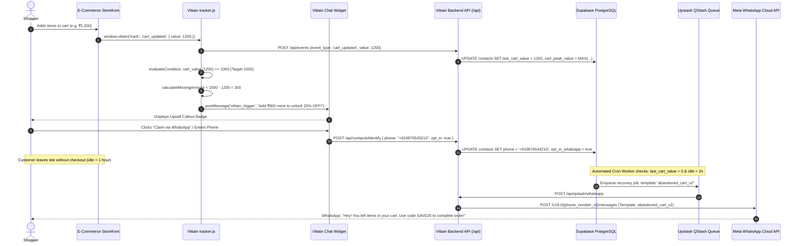

# Abandoned Cart Tracking, Coupon Upsell & WhatsApp Recovery System Design

This document details the end-to-end technical system design for **tracking customer shopping baskets**, **proactively suggesting coupons to increase cart value (upsell triggers)**, **capturing customer WhatsApp numbers as qualified leads**, and **dispatching automated WhatsApp recovery campaigns** if the customer abandons their cart.

---

## 1. Executive Summary & Status Matrix

Vittain contains foundational building blocks for e-commerce telemetry, client-side rule evaluation, and WhatsApp Cloud API campaign dispatching. The table below outlines what is **currently implemented in code**, what is **partially built**, and what **architectural gaps** exist:

| Component | Status | Codebase Location | Description |
| :--- | :---: | :--- | :--- |
| **Basket / Cart Tracking** | **Implemented** | `public/tracker.js`<br/>`src/app/api/tracker/[clientId]/route.ts`<br/>`src/app/api/events/route.ts` | Tracks `cart_updated` via `window.vittain('track', 'cart_updated', { value, items })`. Updates `contacts.last_cart_value` and `contacts.cart_peak_value`. |
| **Rule & Trigger Engine** | **Implemented** | `trigger_rules` table<br/>`src/components/bots/triggers-tab.tsx`<br/>`tracker.js` (client engine) | Evaluates cart thresholds (`>=`, `<=`, `between`), prevents spam (`min_gap_minutes`, `frequency_per_session`), and calculates `missing_amount`. |
| **Coupon Management** | **Implemented** | `coupons` table (`037_coupons.sql`)<br/>`src/app/(dashboard)/campaigns/coupons` | Stores coupon codes, discount types (`percentage` / `fixed`), discount value, and minimum cart value requirement. |
| **In-Chat Coupon Upsell UI** | **Implemented** | `tracker.js` -> `postMessage` -> `public/widget.js` | Injects callout messages into the chat widget: *"You are only ₹{{missing_amount}} away from FLAT ₹500 OFF!"* |
| **WhatsApp Inbound Capture** | **Implemented** | `src/app/api/whatsapp/incoming/route.ts` | Captures customer phone directly when they text the WhatsApp Business number; creates/updates `contacts` record. |
| **Storefront Phone Capture Gate** | ⚠️ **Gap** | Needs Widget UI Form / Action in `public/widget.js` | Chat widget currently takes `visitorName` and `visitorEmail`, but lacks an inline *"Enter WhatsApp number to unlock discount"* gate. |
| **WhatsApp Outbound Pipeline** | **Implemented** | `src/app/api/campaigns/[id]/send/route.ts`<br/>`src/app/api/qstash/whatsapp/route.ts`<br/>`src/lib/whatsapp.ts` | High-throughput QStash queue with Meta 24-hour window compliance check and template message fallback. |
| **Automated Abandoned Cart Cron** | ⚠️ **Gap** | Needs QStash Cron / Edge Function | Currently, recovery campaigns are triggered manually via UI. An automated cron is needed to periodically scan for abandoned carts and trigger dispatch. |

---

## 2. End-to-End Architectural Data Flow



---

## 3. Deep Dive: Subsystem Architecture

### 3.1 Basket & Cart Tracking Subsystem

#### A. Client-Side Telemetry (`public/tracker.js` & `src/app/api/tracker/[clientId]/route.ts`)
Clients integrate the tracking script into their e-commerce storefront:
```html
<script src="https://vittain.ai/api/tracker/YOUR_CLIENT_ID"></script>
```

When a shopper modifies their basket (adds item, removes item, updates quantity), the storefront invokes:
```javascript
window.vittain('track', 'cart_updated', {
  value: 1450.00,
  currency: 'INR',
  items_count: 2,
  items: [
    { product_id: 'prod_987', name: 'Running Shoes', price: 1200.00, quantity: 1 },
    { product_id: 'prod_123', name: 'Sports Socks', price: 250.00, quantity: 1 }
  ]
});
```

#### B. Internal Session State (`window._vittainSession`)
The tracker maintains in-memory session state across single-page navigations:
```javascript
window._vittainSession = {
  triggers_fired: [],       // Prevents duplicate popups in same session
  coupon_sent: false,       // Ensures one coupon per session
  cart_value: 1450.00,      // Synchronized on every cart_updated event
  pages_visited: [],
  last_trigger_at: 1726278000000,
  contact_id: 'vid_abc123',
  session_id: 'vs_998124'
};
```

#### C. Backend Ingestion (`src/app/api/events/route.ts`)
The tracker sends a non-blocking beacon to `POST /api/events`:
```typescript
// 1. Records immutable telemetry event in public.contact_events
await supabase.from('contact_events').insert({
  client_id,
  contact_id,
  event_type: 'cart_updated',
  event_data: { value: 1450.00, currency: 'INR' },
  session_id,
  page_url,
  channel: 'web'
});

// 2. Synchronizes CRM contact commercial properties
if (event_type === 'cart_updated' && event_data?.value !== undefined) {
  const contactUpdates = {
    last_cart_value: event_data.value,
    updated_at: new Date().toISOString()
  };

  const { data: existing } = await supabase
    .from('contacts')
    .select('cart_peak_value')
    .eq('id', contact_id)
    .single();

  if (!existing || event_data.value > (existing.cart_peak_value || 0)) {
    contactUpdates.cart_peak_value = event_data.value;
  }
  await supabase.from('contacts').update(contactUpdates).eq('id', contact_id);
}

// 3. Resets cart if purchase succeeds
if (event_type === 'purchase') {
  await supabase.from('contacts').update({
    lead_status: 'won',
    last_cart_value: 0,
    total_spend: existing.total_spend + event_data.value,
    total_purchases: existing.total_purchases + 1
  }).eq('id', contact_id);
}
```

---

### 3.2 Coupon Suggestion & Cart Upsell Engine

#### A. Database Schema: `public.coupons` (`supabase/037_coupons.sql`)
```sql
CREATE TABLE IF NOT EXISTS public.coupons (
  id              UUID PRIMARY KEY DEFAULT gen_random_uuid(),
  client_id       UUID NOT NULL REFERENCES public.clients(id) ON DELETE CASCADE,
  code            VARCHAR(50) NOT NULL,
  discount_type   TEXT NOT NULL DEFAULT 'percentage', -- 'percentage' | 'fixed'
  discount_value  DECIMAL NOT NULL,
  min_cart_value  DECIMAL DEFAULT 0,
  is_active       BOOLEAN DEFAULT true,
  created_at      TIMESTAMPTZ DEFAULT now()
);
```

#### B. Database Schema: `public.trigger_rules` (`supabase/migration_botspec.sql`)
```sql
CREATE TABLE IF NOT EXISTS public.trigger_rules (
  id                    UUID PRIMARY KEY DEFAULT gen_random_uuid(),
  bot_id                UUID REFERENCES public.bots(id) ON DELETE CASCADE,
  client_id             UUID NOT NULL REFERENCES public.clients(id) ON DELETE CASCADE,
  name                  VARCHAR(255) NOT NULL,
  status                VARCHAR(50) DEFAULT 'active',
  trigger_event         VARCHAR(100) NOT NULL, -- 'cart_updated', 'page_url', 'exit_intent'
  conditions            JSONB DEFAULT '[]',
  actions               JSONB DEFAULT '[]',
  frequency_per_session INTEGER DEFAULT 1,
  frequency_per_day     INTEGER DEFAULT 3,
  min_gap_minutes       INTEGER DEFAULT 5
);
```

#### C. Real-Time Dynamic Upsell Rule Evaluation
When `cart_updated` fires, the client-side rule evaluator checks:
```javascript
// Example Upsell Rule:
// Target: Unlock ₹500 OFF (min_cart: ₹2000) for shoppers with cart >= ₹1000
{
  "name": "Cart Upsell 2000 Target",
  "conditions": [{ "event": "cart_updated", "operator": ">=", "value": "1000", "value2": "2000" }],
  "actions": [{
    "type": "send_message",
    "channel": "web",
    "message": "You are just ₹{{missing_amount}} away from FLAT ₹500 OFF! Add more to qualify.",
    "message_type": "callout"
  }]
}
```

The script evaluates:
1. **Threshold check**: `1450 >= 1000` (true).
2. **Missing Amount**: `target (2000) - current (1450) = 550`.
3. **Spam Control**: Confirms rule ID has not fired in `_vittainSession.triggers_fired` and `now - last_trigger_at >= 5 minutes`.
4. **Dispatch**: Formats string to `"You are just ₹550 away from FLAT ₹500 OFF! Add more to qualify."` and alerts widget via `window.postMessage`.

---

### 3.3 Customer Lead Capture & WhatsApp Number Retrieval

To run WhatsApp campaigns, the platform must convert the anonymous web visitor into a recognized contact with a validated E.164 phone number.

#### A. Inbound WhatsApp Touchpoint (Existing & Fully Working)
When a shopper clicks an external WhatsApp link (e.g. `https://wa.me/15551234567?text=Hi`):
- `POST /api/whatsapp/incoming` receives Meta webhook payload.
- Automatically extracts `from` (MSISDN phone number).
- Upserts the contact in Supabase `contacts` table with `phone = from`, `channel = 'whatsapp'`, and `opt_in_whatsapp = true`.

#### B. Storefront Web Touchpoint (Current Implementation vs Ideal Lead Magnet)
* **Current Web State**: `POST /api/chat/init` accepts `visitorName` and `visitorEmail`. Phone is optional and rarely entered.
* **The Solution (The "Coupon Unlock Lead Magnet")**:
  To capture WhatsApp numbers on the website, the widget presents a gated unlock dialog when an upsell trigger fires:

```
┌────────────────────────────────────────────────────────┐
│ 🎁 Unlock ₹500 OFF Your Order!                         │
│ We'll send your exclusive discount code & cart link    │
│ directly to your WhatsApp.                             │
│                                                        │
│ [ +91 98765 43210                ]                     │
│ [ ☑ Send me cart updates & offers on WhatsApp ]        │
│                                                        │
│ [ Send Code to WhatsApp ]                              │
└────────────────────────────────────────────────────────┘
```

When submitted, this executes:
```javascript
window.vittain('identify', {
  phone: '+919876543210',
  opt_in_whatsapp: true,
  name: 'Customer'
});
```
Backend updates `contacts`:
```sql
UPDATE public.contacts 
SET phone = '+919876543210', 
    opt_in_whatsapp = true,
    last_active_at = now()
WHERE id = $contact_id;
```

---

### 3.4 Abandoned Cart WhatsApp Campaign Recovery Subsystem

#### A. The Meta 24-Hour Customer Window Rule
Meta strictly enforces customer communication policies:
1. **Within 24 Hours of Last Customer Message**: Free-form text messages are allowed.
2. **Outside 24 Hours**: Businesses **cannot** send free-form text. They **must** use pre-approved Meta WhatsApp Message Templates (`template_name`, e.g. `abandoned_cart_v2` with approved variables like `{{1}}` for customer name and `{{2}}` for checkout URL).

Vittain's QStash worker (`src/app/api/qstash/whatsapp/route.ts`) automatically validates this rule before calling Meta:
```typescript
// Enforce 24-Hour Meta Rule
const lastActive = new Date(contact.last_active_at).getTime();
const isWithin24h = (Date.now() - lastActive) < 24 * 60 * 60 * 1000;

if (!isWithin24h && !template_name) {
  // Free-form message blocked to protect client's WhatsApp Business Account rating
  return NextResponse.json({ error: 'Outside 24h window. Template required.' }, { status: 403 });
}
```

#### B. The Campaign Execution Pipeline
1. **Segment Resolution**: `POST /api/campaigns/[id]/send` finds contacts belonging to the Abandoned Cart segment where `phone IS NOT NULL` and `opt_in_whatsapp = true`.
2. **QStash Batching**: Queues jobs in Upstash QStash (`batchJSON`), decoupling HTTP client responses from Meta API rate limits.
3. **QStash Worker**: Calls Meta Graph API `POST /v19.0/{phone_number_id}/messages`.
4. **Delivery Audit**: Inserts delivery status record into `campaign_recipients` (`sent`, `delivered`, `opened`, `clicked`).

---

## 4. Current System Gaps & Implementation Blueprints

To make this system 100% autonomous without requiring manual campaign launches, two specific modules must be deployed:

### Gap 1: Automated Abandoned Cart Detection Cron
**Problem**: Abandoned cart campaigns currently require an operator to click "Send" in the dashboard.
**Blueprint**: A QStash scheduled cron endpoint (`/api/cron/abandoned-cart`) running every 30 minutes:

```typescript
// File: src/app/api/cron/abandoned-cart/route.ts
import { NextRequest, NextResponse } from 'next/server';
import { supabase } from '@/lib/supabase';
import { qstash } from '@/lib/qstash';

export async function POST(req: NextRequest) {
  // Verify secret header or QStash signature
  const authHeader = req.headers.get('authorization');
  if (authHeader !== `Bearer ${process.env.CRON_SECRET}`) {
    return NextResponse.json({ error: 'Unauthorized' }, { status: 401 });
  }

  // 1. Identify Abandoned Carts:
  // - Cart value > 0
  // - Did not complete purchase (lead_status != 'won')
  // - Inactive for > 60 minutes and < 24 hours
  // - Has opted-in WhatsApp phone number
  // - Has not received an abandoned cart message in last 24h
  const oneHourAgo = new Date(Date.now() - 60 * 60 * 1000).toISOString();
  const twentyFourHoursAgo = new Date(Date.now() - 24 * 60 * 60 * 1000).toISOString();

  const { data: abandonedContacts, error } = await supabase
    .from('contacts')
    .select('id, client_id, name, phone, last_cart_value, last_active_at')
    .gt('last_cart_value', 0)
    .neq('lead_status', 'won')
    .eq('opt_in_whatsapp', true)
    .not('phone', 'is', null)
    .lt('last_active_at', oneHourAgo)
    .gt('last_active_at', twentyFourHoursAgo);

  if (error || !abandonedContacts || abandonedContacts.length === 0) {
    return NextResponse.json({ processed: 0 });
  }

  const appUrl = process.env.NEXT_PUBLIC_APP_URL || 'https://vittain.ai';
  const jobs = abandonedContacts.map(contact => ({
    url: `${appUrl}/api/qstash/whatsapp`,
    body: JSON.stringify({
      contact_id: contact.id,
      phone: contact.phone,
      client_id: contact.client_id,
      template_name: 'abandoned_cart_v2',
      template_parameters: [
        { type: 'text', text: contact.name || 'Shopper' },
        { type: 'text', text: contact.last_cart_value.toString() }
      ]
    }),
    headers: { 'Content-Type': 'application/json' }
  }));

  await qstash.batchJSON(jobs);

  return NextResponse.json({ success: true, enqueued: jobs.length });
}
```

### Gap 2: In-Widget WhatsApp Phone Capture Gate
**Problem**: The storefront widget does not provide an interactive component to capture WhatsApp numbers in exchange for unlocking coupon discounts.
**Blueprint**: Add an interactive unlock card in `public/widget.js`:

```javascript
// Widget Form Rendering for WhatsApp Coupon Unlock
function renderWhatsAppCouponGate(container, couponCode, discountText) {
  const gateDiv = document.createElement('div');
  gateDiv.className = 'rag-whatsapp-gate';
  gateDiv.innerHTML = `
    <div style="padding:12px;background:#f0fdf4;border:1px solid #bbf7d0;border-radius:8px;margin:8px 0;">
      <h4 style="margin:0 0 6px;color:#166534;font-size:13px;font-weight:600;">🎁 Unlock ${discountText}</h4>
      <p style="margin:0 0 8px;font-size:12px;color:#374151;">Enter your WhatsApp number to receive your coupon code and save your cart.</p>
      <input type="tel" id="vittain_phone_input" placeholder="+91 98765 43210" 
        style="width:100%;padding:6px 10px;border:1px solid #cbd5e1;border-radius:4px;font-size:12px;box-sizing:border-box;margin-bottom:6px;" />
      <button id="vittain_claim_coupon_btn" 
        style="width:100%;background:#16a34a;color:#fff;border:none;padding:6px 12px;border-radius:4px;font-size:12px;cursor:pointer;font-weight:600;">
        Send Coupon to WhatsApp
      </button>
    </div>
  `;

  container.appendChild(gateDiv);

  gateDiv.querySelector('#vittain_claim_coupon_btn').addEventListener('click', function() {
    const phone = gateDiv.querySelector('#vittain_phone_input').value.trim();
    if (!phone || phone.length < 10) {
      alert('Please enter a valid phone number with country code');
      return;
    }

    // Call identify on backend to bind visitor to phone
    window.vittain('identify', {
      phone: phone,
      opt_in_whatsapp: true
    });

    gateDiv.innerHTML = `
      <div style="padding:10px;background:#ecfdf5;color:#065f46;border-radius:6px;font-size:12px;">
        ✅ Coupon <strong>${couponCode}</strong> unlocked and sent to your WhatsApp!
      </div>
    `;
  });
}
```

---

## 5. Summary of Database Tables & Keys

| Table | Relevant Fields | Purpose in Workflow |
| :--- | :--- | :--- |
| `contacts` | `id`, `client_id`, `name`, `phone`, `opt_in_whatsapp`, `last_cart_value`, `cart_peak_value`, `lead_status`, `last_active_at` | Primary CRM record linking anonymous visitor ID to phone number and tracking cart amounts. |
| `contact_events` | `id`, `client_id`, `contact_id`, `event_type`, `event_data`, `session_id`, `page_url`, `created_at` | Audit log of cart updates, item additions, product views, and purchases. |
| `trigger_rules` | `id`, `bot_id`, `client_id`, `name`, `trigger_event`, `conditions`, `actions`, `frequency_per_session`, `min_gap_minutes` | Configurable rules specifying cart thresholds, message copy, and coupon actions. |
| `coupons` | `id`, `client_id`, `code`, `discount_type`, `discount_value`, `min_cart_value`, `is_active` | Stores discounts presented to customers when qualifying cart thresholds are met. |
| `campaigns` | `id`, `client_id`, `name`, `channel`, `status`, `segment_id` | Defines WhatsApp recovery campaigns and targeting criteria. |
| `campaign_recipients`| `id`, `campaign_id`, `contact_id`, `status`, `delivered_at`, `opened_at` | Tracks delivery and conversion of WhatsApp abandoned cart recovery notifications. |
