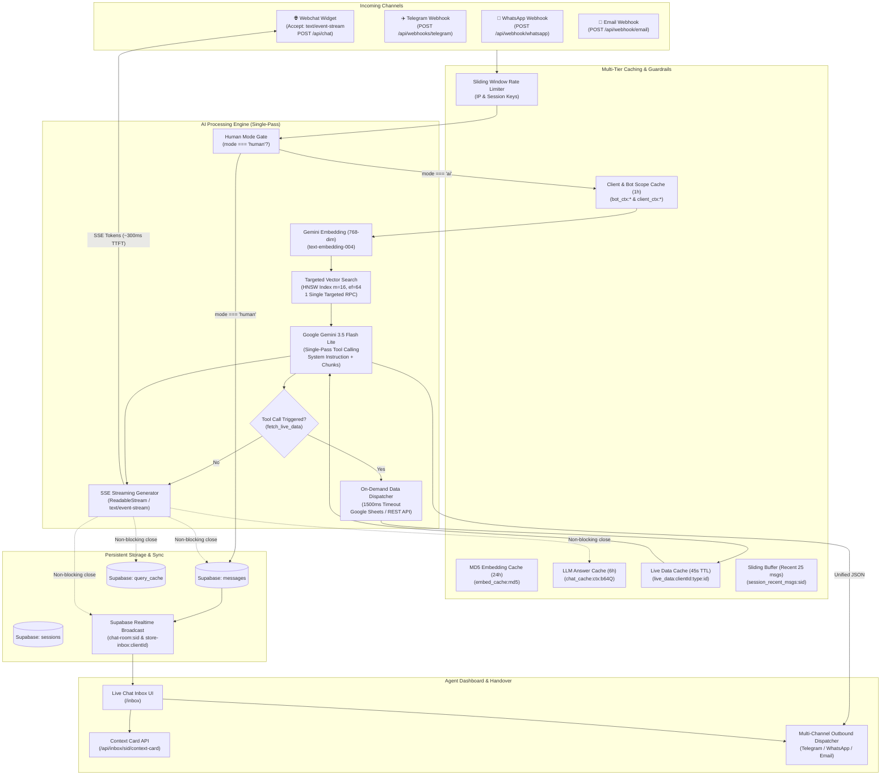
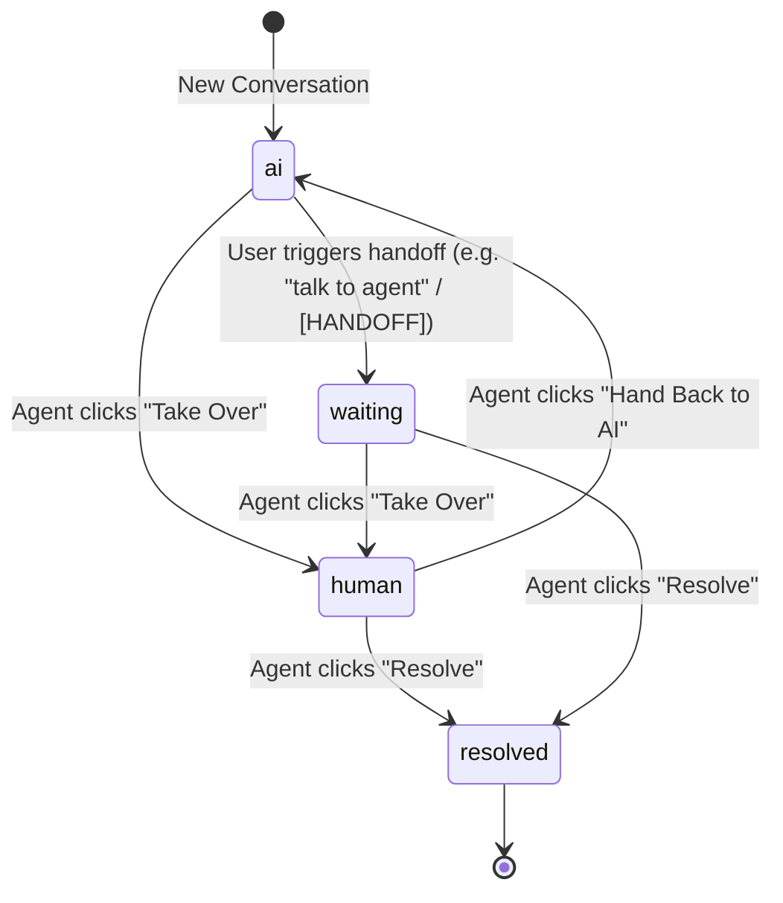

# System Design: Bot Replying Mechanism, RAG Pipeline & Human Handover

This document describes the complete architecture, data flows, caching layers, and human handoff lifecycle of the multi-channel RAG chatbot system, incorporating the single-pass tool-calling architecture, real-time SSE streaming, and HNSW vector search.

---

## 1. High-Level Architecture Overview



---

## 2. Channel Replying Mechanisms

The system supports four distinct communication channels, all sharing unified business logic, RAG retrieval, and session models.

### A. Webchat Widget (`/api/chat`, `/api/chat/sync`, `public/widget.js`)
1. **Session Initiation**: The widget invokes `/api/chat/init` on load, creating or resolving the session row in Supabase (`id` nanoid and `session_id` UUID) along with bot configuration and branding.
2. **User Submits Message**: The widget renders the visitor's bubble optimistically, shows the typing indicator, and sends a POST to `/api/chat` with headers:
   ```http
   Accept: text/event-stream, application/json
   ```
3. **Human Gate Check**: Checks if the session is currently in `human` mode (via Redis `session_mode:${sid}` or PostgreSQL lookup). If in `human` mode, the message is logged via `writeMessage` and broadcast to the Inbox dashboard, bypassing LLM inference.
4. **Targeted Vector Retrieval**: Performs a single targeted vector query using the pre-resolved bot scope (`activeDatasetIds` or `resolvedContextId`) against the HNSW index (`idx_chunks_embedding_hnsw`).
5. **Single-Pass Tool Calling & SSE Streaming**:
   - Yields token deltas immediately as SSE events (`data: {"delta": "..."}`).
   - The widget's `ReadableStream.getReader()` receives the first chunk within **~300–500ms TTFT**, hides the typing indicator, and displays words progressively.
   - If the user asks for live data (e.g. order tracking, shipping status), Gemini automatically invokes `fetch_live_data`, fetches the result from Google Sheets/REST with a 45s Redis cache, and streams the answer.
   - Upon completion, the server sends `data: {"done": true, "source_url": "...", "mode": "..."}`.
6. **Non-blocking Post-Processing**: The server streams the closing chunk immediately and performs database writes (`logMessages`, `query_cache`, lead extraction) asynchronously after stream termination.
7. **Authoritative Persistence & Polling**: The widget commits the final text to its local history. It actively polls `/api/chat/sync` (or listens to Realtime broadcasts) to detect live agent takeovers, system dividers, or proactive upsells.

### B. Telegram (`/api/webhooks/telegram`)
1. **Webhook Reception & Immediate Presence**: Telegram delivers updates containing `{ message: { chat, text, from } }`. Sessions are prefixed deterministically as `tg_${chatId}`.
2. **Sub-50ms Visual Feedback (`sendChatAction: typing`)**: Fires Telegram's `sendChatAction` with action `'typing'` immediately upon receiving the message. The user's Telegram header immediately displays `"bot is typing..."`, eliminating perceived silent wait time.
3. **Exact Question Cache Short-Circuit**: Checks Redis `chat_cache:${resolvedContextId}:${b64Q}` (<2ms). Repeat questions reply immediately over Telegram in **<100ms total** without paying for embedding generation or LLM completion.
4. **Human Gate**: If `session.mode === 'human'`, writes the user message via `writeMessage` and skips automated replies.
5. **Targeted Vector Search & Single-Pass Gemini**: Concurrently retrieves history and embedding (cached by MD5 in Redis for 24h), performs a single targeted vector query via the HNSW index (`idx_chunks_embedding_hnsw`), and runs `generateAnswerUnified` with Gemini 3.5 Flash Lite and tool calling.
6. **Immediate Send & Background Persistence**: Telegram's HTTP API (`sendMessage`) is called immediately. The answer is cached in `chat_cache` (6h TTL) and database audit writes execute asynchronously via `Promise.allSettled`.

### C. WhatsApp (`/api/webhook/whatsapp`)
1. **Webhook Event & Immediate Read Receipt**: Receives Meta Cloud API payload with customer phone number and message body. Session key formatted as `wa_${senderPhone}_${contextId}`. Immediately invokes `markAsRead` (<100ms) to trigger blue ticks as instant acknowledgment.
2. **Exact Question Cache Short-Circuit**: Checks Redis `chat_cache:${contextId}:${b64Q}` (<2ms). Repeat customer inquiries are dispatched back via Meta Graph API in **<150ms** with zero LLM or vector overhead.
3. **Human Gate**: If `mode === 'human'`, logs the message and emits a Realtime broadcast to the live agent dashboard without sending an AI message.
4. **Single-Pass RAG & Tool Calling**: Generates embedding (Redis MD5 cache), queries HNSW vector chunks, and generates answer via `generateAnswerUnified` using Gemini 3.5 Flash Lite.
5. **Outbound Dispatch & Cache-Aside**: Sends WhatsApp text/template via Meta Graph API (`/messages`) and saves answer to Redis `chat_cache` for future requests.

### D. Email (`/api/webhook/email`)
1. **Inbound Webhook**: Ingests incoming email (Subject, Body, Sender).
2. **Triage Engine**: Invokes `triageEmail` via Gemini 3.5 Flash Lite to classify into:
   - `spam`: Suppressed or tagged.
   - `simple_faq`: Auto-replies with knowledge base answer.
   - `complex_business`: Generates an AI draft reply and sets session to `human` for one-click agent approval in the Inbox.
   - `needs_human`: Routes to human agent without auto-reply.

---

## 3. The Ultra-Low Latency RAG Pipeline (Sub-2s & ~300ms TTFT)

```
Incoming Request (User Question)
 │
 ├── [Stage 1: Session Gate & Context Resolution]
 │     ├── Rate Limiting (IP & Session Sliding Window)
 │     ├── Client Context Cache (Redis: client_ctx:* → 1h TTL, <1ms)
 │     ├── Session Mode Check (mode === 'human'? → bypass AI, route to agent)
 │     └── Heuristic Handoff Regex ("talk to human", "speak with agent" → [HANDOFF])
 │
 ├── [Stage 2.A: Manual FAQ Override — Exact Normalized Match] (HIGHEST PRIORITY)
 │     ├── Normalize Question (lowercase, trim, strip punctuation)
 │     └── Exact string lookup in `manual_qa_pairs` (client_id + bot_id / global)
 │           └── HIT: Return/stream authoritative answer VERBATIM in <5ms with ZERO LLM or embedding cost!
 │
 ├── [Stage 2.B: Exact Question Cache Check (chat_cache in Redis)]
 │     └── Redis check `chat_cache:${ctx}:${b64Q}` (6h TTL)
 │           └── HIT: Returns cached answer in <2ms!
 │
 ├── [Stage 3: Embedding Generation & Manual FAQ Vector Search] (Cache Miss Only)
 │     ├── MD5 Embedding Cache (Redis: embed_cache:md5 → 24h TTL)
 │     │     └── Cache Hit: <2ms | Cache Miss: Gemini text-embedding-004 (~200ms)
 │     ├── Manual FAQ Cosine Similarity Search (Supabase: `match_manual_qa_pairs` >= 0.95):
 │     │     └── Sub-5ms HNSW lookup (`idx_manual_qa_pairs_embedding_hnsw`)
 │     │           └── HIT: Return/stream authoritative answer VERBATIM with ZERO LLM call!
 │     └── General Semantic Query Cache (`match_query_cache` >= 0.98 via `idx_query_cache_embedding_hnsw`):
 │           └── HIT: Returns cached response in sub-5ms!
 │
 ├── [Stage 4: Targeted Vector Search (HNSW)]
 │     └── Single Targeted pgvector query:
 │           • match_chunks_by_datasets(activeDatasetIds, embedding, 5)
 │           • Fallback only if 0 results returned
 │           • Sub-10ms recall via idx_chunks_embedding_hnsw (m=16, ef=64)
 │
 ├── [Stage 5: Single-Pass Tool Calling & Real-Time Interim Feedback]
 │     ├── Unified System Prompt:
 │     │     • Identity & Custom Bot Prompt
 │     │     • Strict Operational Rules (Truthfulness, injection resistance, handoff)
 │     │     • Website Knowledge Chunks
 │     ├── Gemini 3.5 Flash Lite (2500ms hard timeout)
 │     │     ├── Tool: fetch_live_data(query_type, identifier)
 │     │     └── If tool invoked:
 │     │           ├── Instant Interim Feedback (<400ms):
 │     │           │     • Webchat SSE: yield "Checking our records for [identifier]...\n\n"
 │     │           │     • Telegram / WhatsApp: onToolCall sends "🔍 Checking our records..."
 │     │           ├── Check Redis live_data cache (45s TTL)
 │     │           ├── Cache miss: Query Google Sheets / REST API (1500ms hard timeout)
 │     │           └── Pass live context to chatSession.sendMessageStream()
 │     └── Yield token deltas via ReadableStream (data: {"delta": "..."})
 │           └── TTFT to client: ~300–500ms (eliminates perceived 4s tool-call delay!)
 │
 └── [Stage 6: Non-Blocking Background Operations] (On Stream Close)
       ├── 1. Store Answer in Redis chat_cache (6h TTL)
       ├── 2. Upsert into Supabase query_cache
       ├── 3. writeMessage to PostgreSQL & Redis Sliding Buffer
       └── 4. Supabase Realtime Broadcast (store-inbox & chat-room)
```

---

## 4. Caching Architecture & TTL Matrix

| Cache Layer | Key Pattern | Storage Engine | TTL | Invalidation Trigger |
|---|---|---|---|---|
| **Rate Limit (IP)** | `rag_chat:${ip}` | Upstash Redis | 5 min | Sliding window expiry |
| **Rate Limit (Session)** | `rag_chat:session:${sid}` | Upstash Redis | 60 sec | Sliding window expiry |
| **Client Context** | `client_ctx:${ctx}` | Upstash Redis | 1 hour | Admin client settings change |
| **Bot Context** | `bot_ctx:${botId}` | Upstash Redis | 1 hour | Bot prompt or dataset link update |
| **Telegram Config** | `tg_bot_config` | Upstash Redis | 10 min | Bot token or integration update |
| **Embedding Vector** | `embed_cache:${md5(text)}` | Upstash Redis | 24 hours | Deterministic (never changes for same text) |
| **LLM Query Cache** | `chat_cache:${ctx}:${b64Q}` | Upstash Redis | 6 hours | Question re-evaluated or TTL expiry |
| **Live Database Data** | `live_data:${clientId}:${type}:${id}` | Upstash Redis | 45 sec | On-demand cache-aside refresh |
| **Recent Message Buffer** | `session_recent_msgs:${sid}` | Upstash Redis (List) | 1 hour | Trimmed to latest 25 messages (`ltrim`) |
| **Latest Message CAS** | `session_last_id:${sid}` | Upstash Redis (String) | 60 sec | Atomic CAS via Lua script (`setLastIdIfGreater`) |
| **Session Mode** | `session_mode:${sid}` | Upstash Redis | 24 hours | Agent Takeover / Handback / Resolve |
| **Semantic DB Cache** | `query_cache` table | PostgreSQL (pgvector) | Permanent | Hit counter incremented on match |

### Atomic CAS Read-Repair Pattern (`src/lib/redis/atomic.ts`)
To eliminate race conditions where slower database backfills overwrite newer message arrivals:
- The Lua script compares message timestamp epochs (`new_ts >= current_ts`).
- If true, updates `session_last_id:${sid}` atomically.
- Prevents out-of-order polling flickers in the live widget.

---

## 5. Human Handover Lifecycle & State Machine

The conversation lifecycle transitions between four modes:



### State Definitions

| State | Who Responds? | Bot Behavior | Inbox Sidebar Badge |
|---|---|---|---|
| **`ai`** | AI Assistant | Automated RAG single-pass answers with tool calling. | Green ("AI Mode") |
| **`waiting`** | None (Queued) | Bot announces handoff and pauses. Ticket opened. | Orange / Pulse ("Needs Agent") |
| **`human`** | Human Agent | AI responses completely blocked. Agent types in Inbox. | Blue ("Human Takeover") |
| **`resolved`** | None | Conversation closed. System divider displayed. | Gray ("Closed") |

---

## 6. End-to-End Handover Data Flows

### A. Customer Requests Human Agent
1. Customer types: *"I want to speak with a human agent"*.
2. Heuristic check or Gemini unified model outputs `[HANDOFF]`.
3. Server updates `sessions.mode = 'waiting'`.
4. Creates a ticket in `tickets` table and an entry in `handoff_requests`.
5. Redis key `session_mode:${sessionId}` is set to `'waiting'` (24h).
6. Widget displays bot handoff message: *"I am connecting you to a human agent who can assist you further."*
7. Realtime event broadcasts to `store-inbox:${clientId}`. The conversation in the dashboard lights up with an orange alert badge.

### B. Support Agent Takes Over
1. Agent selects the conversation in [`/inbox`](src/app/(dashboard)/inbox/page.tsx).
2. Agent clicks **"Take Over"** button.
3. Client sends `PUT /api/inbox/[sessionId]` with `{ action: 'takeover' }`.
4. Server:
   - Sets `sessions.mode = 'human'`.
   - Sets Redis `session_mode:${sessionId} = 'human'`.
   - Inserts a system message into `messages`:
     ```json
     {
       "role": "system",
       "content": "You are now connected with a support agent.",
       "session_id": "...",
       "channel": "website"
     }
     ```
   - Realtime broadcasts `inbox_update` and `new_message` on `chat-room:${sid}`.
5. In the Widget:
   - The system message displays as a centered rounded pill divider (`.rag-system-msg`).
   - The bot stops auto-replying to any subsequent customer inputs.

### C. Agent Sends Reply (Multi-Channel Delivery & Zero-Flicker Optimistic UI)
1. Agent types in the chat composer and presses Send.
2. **Optimistic Rendering**: The Inbox immediately renders an optimistic bubble (`temp-...`).
3. **Server Action**: Invokes `sendAgentReply(sessionId, text)`.
4. **Authoritative Message Insertion**: Calls `writeMessage` (`src/lib/chat/writeMessage.ts`):
   - Inserts authoritative row in PostgreSQL `messages`.
   - Appends message to Redis sliding-window cache.
   - Updates `session_last_id` via atomic Lua script.
   - Emits Supabase Realtime broadcast to `chat-room:${sid}`.
5. **Outbound Dispatcher**:
   - **Telegram**: POST to `https://api.telegram.org/bot${token}/sendMessage`.
   - **WhatsApp**: POST to Meta Graph API (`/messages`).
   - **Email**: Dispatches via Nodemailer with threaded `In-Reply-To` headers.
   - **Website**: Widget receives Realtime broadcast or polls `/api/chat/sync`.
6. **Optimistic UI Reconciliation (Zero-Flicker Algorithm)**:
   - When the Realtime broadcast arrives *before* the server action completes:
     - `handleIncomingMessage` searches `messages` state for a matching optimistic bubble (`temp-...`) with the same role and text.
     - It **replaces** the temp bubble in-place with the confirmed DB message.
   - When the server action resolves:
     - `handleSend` checks if Realtime already ingested the message ID. If so, cleanly removes any remaining temp bubble without layout jump.

### D. Agent Hands Back to AI
1. Agent clicks **"Hand Back to AI"**.
2. Client sends `PUT /api/inbox/[sessionId]` with `{ action: 'handback' }`.
3. Server updates `sessions.mode = 'ai'`, caches in Redis, and inserts system message:
   `"Our agent has handed you back to the AI assistant. How can I help you?"`.
4. AI Resuming: On the customer's next message, the human mode gate opens, and Gemini 3.5 Flash Lite immediately resumes automated answering.

### E. Agent Resolves Conversation
1. Agent clicks **"Resolve"**.
2. Server sets `sessions.status = 'resolved'`, updates ticket status to `resolved`, and inserts system message:
   `"This conversation has been closed. Thank you for reaching out!"`.
3. Conversation moves to the **Resolved** tab in the Inbox sidebar.

### F. Inbox Context Card API (`/api/inbox/[sessionId]/context-card`)
When an agent selects any conversation in the Inbox, the dashboard fetches the Context Card to display real-time customer intelligence in the right sidebar:
- **Customer Details**: Name, email, phone number, channel icon.
- **Last User Question**: Extracts the most recent question asked by the customer for immediate context.
- **Conversation Stats**: Message count, session duration, mode status, ticket urgency.
- **One-Click Actions**: Takeover, Handback, Mark Resolved, View Customer Profile.

---

## 7. Database Schema & Vector Search Optimization

### Vector Cosine Search with HNSW

#### 1. Knowledge Chunks (`supabase/043_chunks_hnsw_index.sql`)
```sql
CREATE INDEX IF NOT EXISTS idx_chunks_embedding_hnsw
  ON public.chunks
  USING hnsw (embedding vector_cosine_ops)
  WITH (m = 16, ef_construction = 64);
```
- **HNSW (`m=16, ef_construction=64`)**: Builds a multi-layer geometric graph for vector similarity.
- **Performance**: Yields sub-10ms cosine distance retrieval, replacing sequential IVFFlat cluster scans.

#### 2. Semantic Query Cache & QA Pairs (`supabase/044_query_cache_qa_pairs_hnsw_index.sql`)
```sql
-- Semantic Cache Index: Eliminates sequential table scans during Stage 2 fast path
CREATE INDEX IF NOT EXISTS idx_query_cache_embedding_hnsw
  ON public.query_cache
  USING hnsw (question_embedding vector_cosine_ops)
  WITH (m = 16, ef_construction = 64);

-- Manual QA Pairs Index: Accelerates Stage 1 deterministic FAQ hits
CREATE INDEX IF NOT EXISTS idx_qa_pairs_embedding_hnsw
  ON public.qa_pairs
  USING hnsw (question_embedding vector_cosine_ops)
  WITH (m = 16, ef_construction = 64);
```

#### 3. Manual FAQ Overrides (`supabase/045_manual_qa_pairs.sql`)
```sql
CREATE TABLE IF NOT EXISTS public.manual_qa_pairs (
  id UUID PRIMARY KEY DEFAULT gen_random_uuid(),
  client_id UUID NOT NULL REFERENCES public.clients(id) ON DELETE CASCADE,
  bot_id UUID REFERENCES public.bots(id) ON DELETE CASCADE,
  question TEXT NOT NULL,
  normalized_question TEXT NOT NULL,
  question_embedding VECTOR(768),
  answer TEXT NOT NULL,
  is_active BOOLEAN DEFAULT true,
  updated_at TIMESTAMPTZ DEFAULT now(),
  created_at TIMESTAMPTZ DEFAULT now()
);

CREATE INDEX IF NOT EXISTS idx_manual_qa_pairs_embedding_hnsw
  ON public.manual_qa_pairs
  USING hnsw (question_embedding vector_cosine_ops)
  WITH (m = 16, ef_construction = 64);
```

### Cache Invalidation on FAQ Edit
When an FAQ pair is inserted, updated, or deleted, `invalidateFaqCaches`:
1. Executes `purge_similar_query_cache(clientId, embedding, 0.95)` to delete any rows in `public.query_cache` with cosine similarity &ge; 0.95.
2. Purges Redis keys `chat_cache:${contextId}:${b64Q}` for the edited question and all semantically matching questions.
3. Guarantees that corrected merchant answers take effect **immediately** rather than waiting for 6-hour or permanent cache expirations.

### Dual-Format Session ID Resolution
To ensure sessions created with nanoids (`sz0r...`) and UUIDs (`session_id`) reconcile transparently:
```typescript
supabase
  .from('sessions')
  .select('id, session_id, mode, client_id')
  .or(`id.eq.${sessionId},session_id.eq.${sessionId}`)
  .maybeSingle()
```

---

## 8. Key Files Reference

| Purpose | File Path |
|---|---|
| **Main Web Chat API (SSE & JSON)** | [`src/app/api/chat/route.ts`](src/app/api/chat/route.ts) |
| **Manual FAQ API (CRUD & Invalidation)** | [`src/app/api/manual-qa/route.ts`](src/app/api/manual-qa/route.ts) |
| **Manual FAQ Overrides UI Tab** | [`src/components/bots/faq-overrides-tab.tsx`](src/components/bots/faq-overrides-tab.tsx) |
| **FAQ Normalizer Utility** | [`src/lib/manual-qa/normalize.ts`](src/lib/manual-qa/normalize.ts) |
| **FAQ Cache Invalidator** | [`src/lib/manual-qa/invalidation.ts`](src/lib/manual-qa/invalidation.ts) |
| **Widget Polling / Fast-Path Sync** | [`src/app/api/chat/sync/route.ts`](src/app/api/chat/sync/route.ts) |
| **Telegram Webhook** | [`src/app/api/webhooks/telegram/route.ts`](src/app/api/webhooks/telegram/route.ts) |
| **WhatsApp Webhook** | [`src/app/api/webhook/whatsapp/route.ts`](src/app/api/webhook/whatsapp/route.ts) |
| **Email Webhook & Triage** | [`src/app/api/webhook/email/route.ts`](src/app/api/webhook/email/route.ts) |
| **Primary LLM Client (Gemini 3.5 Flash Lite + Tools)** | [`src/lib/gemini.ts`](src/lib/gemini.ts) |
| **Core RAG Answer Interface** | [`src/lib/groq.ts`](src/lib/groq.ts) |
| **Embeddings & 24h Redis Cache** | [`src/lib/embeddings.ts`](src/lib/embeddings.ts) |
| **Live Data Source & 45s Cache-Aside** | [`src/lib/datasource.ts`](src/lib/datasource.ts) |
| **Hard Timeout Utility** | [`src/lib/utils/withTimeout.ts`](src/lib/utils/withTimeout.ts) |
| **Unified Authoritative Message Writer** | [`src/lib/chat/writeMessage.ts`](src/lib/chat/writeMessage.ts) |
| **Handoff Lifecycle API** | [`src/app/api/inbox/[sessionId]/route.ts`](src/app/api/inbox/[sessionId]/route.ts) |
| **Inbox Context Card API** | [`src/app/api/inbox/[sessionId]/context-card/route.ts`](src/app/api/inbox/[sessionId]/context-card/route.ts) |
| **Live Chat Inbox UI** | [`src/app/(dashboard)/inbox/page.tsx`](src/app/(dashboard)/inbox/page.tsx) |
| **Bot Edit Settings Page** | [`src/app/(dashboard)/bots/[id]/edit/page.tsx`](src/app/(dashboard)/bots/[id]/edit/page.tsx) |
| **Web Widget Frontend (SSE Reader)** | [`public/widget.js`](public/widget.js) |
| **Chunks HNSW Index Migration** | [`supabase/043_chunks_hnsw_index.sql`](supabase/043_chunks_hnsw_index.sql) |
| **Query Cache & QA Pairs HNSW Index Migration** | [`supabase/044_query_cache_qa_pairs_hnsw_index.sql`](supabase/044_query_cache_qa_pairs_hnsw_index.sql) |
| **Manual FAQ Overrides Schema Migration** | [`supabase/045_manual_qa_pairs.sql`](supabase/045_manual_qa_pairs.sql) |
