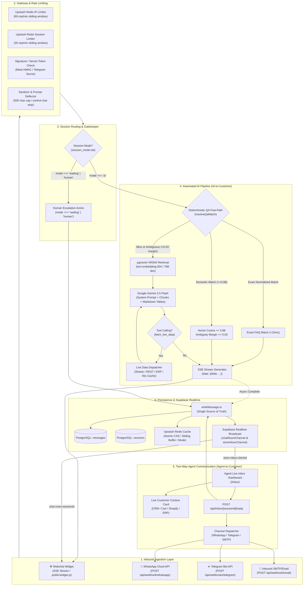
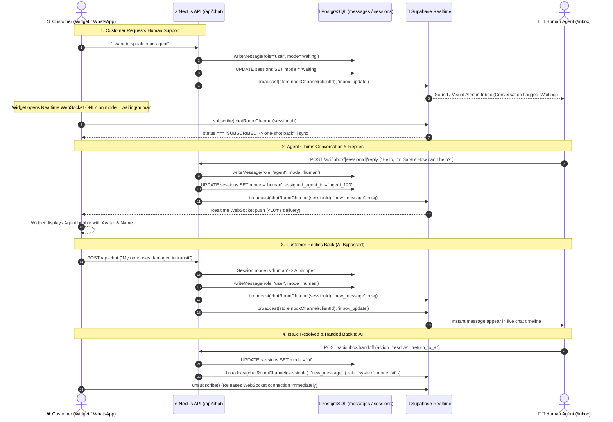

# Multi-Channel Chatbot System Design: AI-to-Customer, Two-Way Agent Handover & Supabase Realtime

This document provides the end-to-end production system design of the Chatbot Platform. It details the complete request lifecycle across automated AI generation, two-way human agent communication, Supabase Realtime synchronization, zero-polling WebSocket architecture, and multi-tiered caching.

---

## 1. System Architecture Overview



---

## 2. From AI to Customer: The Automated Conversational Pipeline

When a customer messages the chatbot (via Webchat, WhatsApp, Telegram, or Email), the system executes a multi-tiered retrieval and inference sequence designed for sub-second response times and zero hallucination.

### 2.1 Gateway, Security & Rate Limiting
1. **Dual-Layer Sliding Window Rate Limiter**:
   - **IP-Level**: 60 requests/minute per client IP (`rag_chat:{ip}`).
   - **Session-Level**: 30 requests/minute per session ID (`rag_chat_session:{sessionId}`). Prevents individual sessions behind shared corporate Wi-Fi or CGNAT mobile networks from monopolizing worker capacity.
   - **Fail-Open Design**: Redis calls are bounded by 1500ms timeouts and encapsulated in safe wrappers. Transient Redis network delays never block customer conversations.
2. **Input Sanitization & Length Gating**:
   - Inbound queries are capped at 500 characters. Control characters, Unicode directional overrides, and adversarial prompt-injection prefixes are filtered prior to vectorization.

### 2.2 The Deterministic Q&A Fast-Path (`resolveQaMatch.ts`)
To eliminate LLM generation costs and reduce latency from 3–5 seconds to $<10\text{ms}$ on standard customer questions, every AI query is evaluated by the calibrated fast-path:
- **Priority 1: Bot-Specific Exact Match**: Looks up normalized text in `manual_qa_pairs` filtered to the current `bot_id`.
- **Priority 2: Client Global Exact Match**: Looks up normalized text in `manual_qa_pairs` scoped to `client_id` (fallback).
- **Priority 3: Calibrated Semantic Vector Match ($\ge 0.88$)**:
  - Computes cosine similarity against vectorized FAQ embeddings.
  - Empirically calibrated down from 0.95 to **0.88** to reliably catch natural phrasing and paraphrasing (e.g. *"who is the head chef"* vs *"name me the head chef"*).
- **Ambiguity Margin Check ($\ge 0.03$)**:
  - The top matching FAQ must beat the runner-up candidate by at least **$0.03$**.
  - If the margin is $< 0.03$ (e.g., "Do you ship to Canada?" scoring 0.89 and "Do you ship internationally?" scoring 0.88), the query is treated as ambiguous and falls through to the full LLM inference engine.
- **Near-Miss Logging (`public.qa_near_misses`)**:
  - Questions scoring between $0.80$ and $0.879$, or failing the margin check, are logged asynchronously to `qa_near_misses` to recommend high-impact FAQ additions to the merchant.

### 2.3 RAG Retrieval & Knowledge Scoping
- **Embedding Cache**: Inbound query embeddings are cached in Upstash Redis (`embed_cache:{md5}`) for 24 hours to prevent duplicate embedding calls.
- **pgvector HNSW Indexing**: Uses Google Gemini `text-embedding-004` (768 dimensions) querying PostgreSQL `chunks` via an HNSW index (`idx_chunks_embedding_hnsw`, parameters $m=16, ef=64$).
- **Multi-Tenant Partitioning**: Vectors are strictly partitioned by `context_id` and assigned `dataset_id` arrays, guaranteeing zero cross-customer data leakage.

### 2.4 LLM Generation & Markdown Table Enforcement
- **Model**: Google Gemini 3.5 Flash / Flash Lite with system instructions and persona directive.
- **Single-Pass Tool Calling (`fetch_live_data`)**:
  - For live operational inquiries (order tracking, inventory status, delivery schedules), Gemini issues a function call in its initial pass.
  - The server queries connected Google Sheets or REST/ERP backends with a 1500ms timeout and a 45-second Redis cache (`live_data:{clientId}:{type}:{id}`).
  - Live data values pass through `sanitizeLiveDataValue()`, stripping HTML tags and neutralization tokens to prevent indirect prompt injection from compromised spreadsheets.
- **Structured Data Presentation (Markdown Tables)**:
  - System prompt Rule 9 instructs Gemini to format tabular and structured status data (Order ID, Placed Date, Product, Status) into GitHub-flavored Markdown tables.
  - In `public/widget.js`, `parseMarkdown()` parses table delimiters into responsive, scrollable `.rag-md-table` HTML with left text alignment.
- **Server-Sent Events (SSE) Streaming**:
  - Tokens stream in real time (`data: {"delta": "..."}`) with a Time-to-First-Token (TTFT) of ~300ms.
  - Upon stream completion, the widget closes the connection, commits the message to local state, and writes the message asynchronously to PostgreSQL and Redis.

---

## 3. Two-Way Communication: Agent-to-Customer & Customer-to-Agent

The platform provides a live two-way customer support inbox (`/inbox`) with stateful human handoff.



### 3.1 Escalation Triggers
A conversation transitions from AI mode to Human Agent mode through four paths:
1. **Explicit Customer Intent**: Visitor types natural language requests ("talk to a human", "customer care agent", "representative") or taps the quick reply button.
2. **Configured Returns & Replacement Flows**: Multi-step triggers ask for Order ID, verify the 7-day returnable window, collect the issue description, create a ticket, and escalate to human handoff.
3. **Sentiment & Low Confidence**: Successive low-confidence AI responses or detected customer frustration automatically escalate the session.
4. **Out-of-Hours Queuing**: If outside configured business hours, the conversation is marked `waiting` and logged with an offline auto-reply.

### 3.2 The Single Source of Truth: `writeMessage.ts`
All message insertion—whether from customer chat, AI streaming completion, agent reply, or system event—routes through [`src/lib/chat/writeMessage.ts`](file:///Users/arsotoxic/Documents/final/rag-widget/src/lib/chat/writeMessage.ts):
```ts
export async function writeMessage(params: WriteMessageParams) {
  // 1. Single database write returning authoritative row
  const { data: message } = await supabase
    .from('messages')
    .insert({ session_id, role, content, mode, channel, context_id, bot_id })
    .select('id, session_id, role, content, mode, channel, created_at')
    .single();

  // 2. Concurrently update Redis & Realtime via Promise.allSettled
  await Promise.allSettled([
    setLastIdIfGreater(sessionId, message.id, message.created_at), // Redis Atomic CAS
    cacheMessagePayload(sessionId, cachedMsg),                     // 25-msg sliding buffer
    redis.set(`session_mode:${sessionId}`, mode, { ex: 86400 }),   // 24h mode gate
    broadcastRealtime(chatRoomChannel(sessionId), 'new_message', message),
    broadcastRealtime(storeInboxChannel(clientId), 'inbox_update', { session_id, snippet })
  ]);
  return message;
}
```

### 3.3 Two-Way Agent Reply Dispatch (`/api/inbox/[sessionId]/reply`)
When an agent submits a message from the Inbox:
1. Resolves `sessionId`, `context_id`, and `channel` from PostgreSQL.
2. Invokes `writeMessage({ role: 'agent', mode: 'human', content })`.
3. Updates `sessions.mode = 'human'` and `sessions.last_message_at`.
4. If the conversation originated on **Email (SMTP)**, dispatches the email response via nodemailer. If on **WhatsApp** or **Telegram**, invokes their outbound messaging APIs. If on **Webchat**, the Realtime broadcast delivers the message via WebSocket directly to the customer's open bubble in $<10\text{ms}$.

### 3.4 Customer Reply During Human Mode
When the customer responds:
1. Inbound handler (`/api/chat` or webhook) checks `session_mode:{sessionId}`.
2. If `mode === 'human'` or `mode === 'waiting'`, **LLM inference is completely bypassed**.
3. The message is written to the database with `mode = 'human'`.
4. Broadcasts to `chatRoomChannel(sessionId)` and `storeInboxChannel(clientId)`, instantly rendering the bubble on the agent's screen.

---

## 4. Supabase Realtime Architecture & The Zero-Polling Lifecycle

Timer-based recurring polling (`setInterval`, `setTimeout` loops) has been **completely eliminated** from the codebase. It has been replaced by a lazy Realtime WebSocket lifecycle with event-driven backfills.

### 4.1 Canonical Channel Name Parity
To prevent channel name mismatch bugs where the backend broadcasts to one channel and the frontend listens to another, all channel names are generated from a single shared utility: [`src/lib/realtime/channels.ts`](file:///Users/arsotoxic/Documents/final/rag-widget/src/lib/realtime/channels.ts):
```ts
export function chatRoomChannel(sessionId: string): string {
  return `chat-room:${sessionId}`;
}

export function storeInboxChannel(clientId: string): string {
  return `store-inbox:${clientId}`;
}
```
Imported symmetrically by:
- **Backend Broadcasters**: `writeMessage.ts`, `/api/chat/route.ts`, `/api/inbox/[sessionId]/reply/route.ts`
- **Frontend Subscribers**: `public/widget.js`, `ChatWidget.tsx`, `/inbox/page.tsx`

### 4.2 Lazy WebSocket Subscription (Quota Protection)
Connecting thousands of concurrent e-commerce website visitors to WebSockets would rapidly breach Supabase connection quotas (200 on Free, 500 on Pro). 

To prevent quota exhaustion:
- **During Normal AI Chat**: The widget holds **zero WebSockets**. All AI interactions stream over HTTP Server-Sent Events (SSE).
- **During Handoff Mode (`waiting` | `human`)**: The widget dynamically instantiates the Supabase Realtime client and subscribes to `chat-room:${sessionId}`.
- **On Minimized or Resolved**: When the user minimizes the widget or the agent marks the conversation `resolved`, the widget calls `channel.unsubscribe()` and releases the connection immediately.

```javascript
// public/widget.js — Lazy WebSocket connection
function updateRealtimeSubscription() {
  if (isHandoffMode && isOpen && sessionId && config.supabase_url) {
    if (realtimeChannel) return; // already active
    
    realtimeClient = window.supabase.createClient(config.supabase_url, config.supabase_anon_key);
    realtimeChannel = realtimeClient.channel('chat-room:' + sessionId)
      .on('broadcast', { event: 'new_message' }, ({ payload }) => {
        mergeIncomingMessages([payload]);
        renderMessages();
      })
      .subscribe((status) => {
        if (status === 'SUBSCRIBED') {
          syncMessages(); // Single one-shot backfill on connect
        }
      });
  } else {
    if (realtimeChannel) {
      realtimeChannel.unsubscribe(); // Immediate socket teardown
      realtimeChannel = null;
    }
  }
}
```

### 4.3 Reconnect-Triggered Backfill Safety Net
Instead of running polling intervals, the client uses **event-driven reconciliation**:
- **On Channel Connect**: When `status === 'SUBSCRIBED'`, runs a single one-shot `GET /api/chat/sync?last_id=X` to retrieve any messages sent during connection establishment.
- **On Tab Refocus**: When the user returns to the browser tab (`visibilitychange` / `focus`), fires a single backfill request debounced by 300ms (preventing duplicate requests on rapid alt-tabbing).
- **On Widget Open**: When the user expands the launcher, syncs once.
- **Result**: Zero continuous polling requests hitting the server while maintaining guaranteed message delivery.

---

## 5. Multi-Tier Caching & Persistence Topology

| Tier | Layer | Technology | Key Pattern | TTL | Latency | Purpose |
| :--- | :--- | :--- | :--- | :--- | :--- | :--- |
| **L1.A** | Edge Limiting | Upstash Redis | `rag_chat:{ip}` | 60s | $<2\text{ms}$ | Rate limits IPs against scraping and DoS attacks. |
| **L1.B** | Session Limiting | Upstash Redis | `rag_chat_session:{sessionId}` | 60s | $<2\text{ms}$ | Prevents abusive sessions behind shared CGNAT networks. |
| **L2** | Session Mode | Upstash Redis | `session_mode:{sessionId}` | 24h | $<2\text{ms}$ | Immediate gate between AI inference and human agent routing. |
| **L3** | Last Message ID | Upstash Redis | `session_last_id:{sessionId}` | 1h | $<2\text{ms}$ | Atomic CAS pointer for forward-only message reconciliation. |
| **L4** | Message Buffer | Upstash Redis | `session_recent_msgs:{sessionId}` | 1h | $<2\text{ms}$ | Sliding buffer of 25 recent messages; 0 database hits for recent history. |
| **L5** | Query Embeddings | Upstash Redis | `embed_cache:{md5(query)}` | 24h | $<5\text{ms}$ | Avoids re-vectorizing identical questions with Gemini Embedding API. |
| **L6** | Answer Cache | Upstash Redis | `chat_cache:{ctx}:{botId}:{hash}` | 6h | $<5\text{ms}$ | Serves identical repeat queries instantly with zero LLM generation cost. |
| **L7** | Live Data | Upstash Redis | `live_data:{clientId}:{type}:{id}` | 45s | $<2\text{ms}$ | Buffers live external Google Sheet and ERP lookups. |
| **L8** | Durable Storage | PostgreSQL | `messages`, `sessions`, `chunks` | $\infty$ | $15–35\text{ms}$ | Authoritative relational data and pgvector HNSW semantic vector store. |

---

## 6. Multi-Channel & Cross-Bot Routing Engine

The system supports deploying bots across diverse communication channels with channel-specific UI filtering and automated routing:

1. **Channel Deployment**:
   - **Webchat**: Full widget with SSE token streaming, Markdown tables, and frosted glass design.
   - **WhatsApp**: Meta Cloud API integration with automatic read receipts (`markAsRead`) and template notifications.
   - **Telegram**: Webhook-based integration with immediate `sendChatAction: typing` feedback.
   - **Email (SMTP)**: Inbound email parsing with thread-based replies.
2. **Bot-to-Bot Handoff Routing**:
   - Configured in **Behavior & Flow Rules**.
   - Example: A **Sales Bot** detects a return or warranty inquiry and displays a direct handoff button redirecting the customer to the specialized **Support Bot**.
3. **Channel-Specific UI Isolation**:
   - For non-web bots (WhatsApp, Telegram, Email), website popup options—such as **Popup Bubble Only**, **Auto-Open Delays**, **Timed Popups & Nudges Manager**, and **Appearance & Integration** snippet tabs—are strictly hidden in the dashboard to maintain a clean channel-specific configuration.
