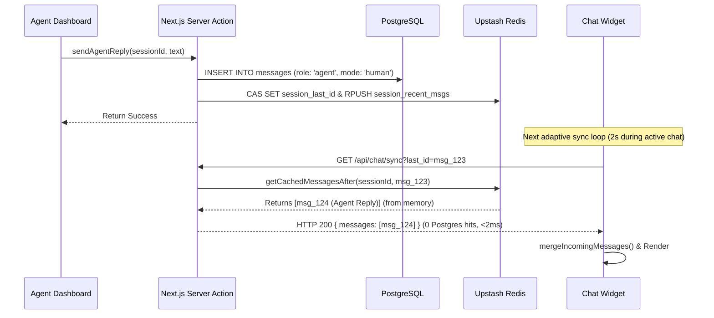
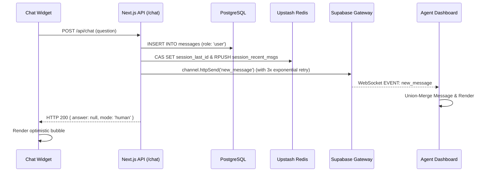

# Vittain Chat: Two-Way Communication Architecture

This document details how the two-way real-time communication operates between the Customer Chat Widget (Storefront) and the Agent Dashboard Inbox. 

We use an **Asymmetric Routing Pattern**. 
1. **Agents (Dashboard)** use persistent WebSockets for instant, low-latency updates.
2. **Customers (Widget)** use a smart, zero-overhead REST synchronization protocol (`last_id` polling) to avoid hitting WebSocket connection limits when thousands of visitors are on the site.

---

## 1. Customer Chat Widget (Smart Polling)

To ensure the Next.js server and PostgreSQL database stay at ~0% CPU load while keeping chat highly responsive, the widget uses a combination of Redis Fast-Paths and active-state detection.

### 1.1 Zero-Overhead Polling Rules
The widget (`public/widget.js`) uses an aggressive polling loop (`~2000ms`), but it is **strictly conditional**:
- **Active Only When Open**: Polling begins the millisecond the user clicks to open the chat bubble.
- **Instant Suspend**: Polling halts completely (`clearTimeout`) the moment the chat is minimized or closed.
- **Tab Visibility**: Polling is tied to the browser's `Visibility API`. If the user switches tabs, polling pauses instantly and resumes upon refocus.

### 1.2 The `last_id` Synchronization Protocol
When the widget polls for new messages, it calls `GET /api/chat/sync?session_id=X&last_id=Y`:
1. **Extraction**: The widget scans its local message array backwards to find the database ID of the latest confirmed message (skipping optimistic `temp-*` IDs).
2. **Fast-Path Check (<2ms)**: 
   - The Next.js API route connects to Upstash Redis and checks `session_last_id:{sessionId}`.
   - If the client's `last_id` strictly matches the Redis `cachedLastId`, the server immediately returns `{ messages: [] }` with `HTTP 200`. 
   - **No Postgres query is executed**. The server worker thread is freed in ~1-2 milliseconds.
3. **Cache Miss / New Message**: 
   - If `last_id` does not match, the sync route queries PostgreSQL to fetch the newest messages, updates the Redis `session_last_id` to the new latest ID, and returns the messages to the widget.
4. **Intelligent Merge**: The widget's `mergeIncomingMessages()` reconciles the incoming data, deduplicates by ID, and assigns CSS classes based on the sender (`.rag-msg.human` for agents, `.rag-msg.system` for handoff notifications).

---

## 2. Agent Dashboard Inbox (Realtime Push)

The dashboard is designed for high-concurrency human support operations.

### 2.1 Initial On-Demand Load
- **Server Actions**: Uses direct-to-database Next.js Server Actions (`fetchConversationsList`, `fetchChatHistory`).
- Bypasses API routing layers. Loads the sidebar and the latest 25 messages of a selected conversation instantly upon opening the dashboard.

### 2.2 Supabase Realtime (WebSockets)
Instead of polling the database, the agent dashboard connects directly to the Supabase Realtime Gateway via `@supabase/ssr`.
- **`chat-thread:{sessionId}`**: Listens for new `messages` payloads in the currently active chat thread.
- **`store-inbox:{clientId}`**: Listens for `inbox_update` events to bump conversations to the top of the sidebar and update the snippet preview.
- **Deduplication**: Message arrays are merged using a `Map<string, ChatMessage>` to ensure incoming realtime broadcasts don't clash or flash against server action payloads.

### 2.3 Explicit REST Broadcasting
To avoid deprecation warnings and missing packets when the Next.js backend attempts to send realtime events (since serverless routes don't maintain open WebSockets), we use an explicit HTTP REST broadcast:
- The backend helper `broadcastRealtime()` uses `channel.httpSend()` to push `new_message` or `inbox_update` events directly to the Supabase Realtime Gateway, which then fans them out to connected Agent WebSockets.

---

## 3. Caching & State Management

Redis is the core of our high-performance scaling. We aggressively cache session metadata and sliding-window message payloads to deflect 99% of synchronization queries away from Postgres.

### 3.1 Redis Keys
| Key | Expiry | Purpose |
| --- | --- | --- |
| `session_last_id:{id}` | 60s | The UUID of the last inserted message in this session. Updated atomically forward-only via Lua Compare-And-Set. |
| `session_recent_msgs:{id}` | 3600s (1h) | 25-message sliding window buffer. Returns new messages directly from memory without hitting PostgreSQL. |
| `session_mode:{id}` | 86400s (24h) | Current state of the session (`ai` vs `human`). Controls whether the widget says "Online" or "Support Agent Connected". |

### 3.2 Invalidation & Forward-Only Update Strategy
1. **Single Source of Truth Write (`writeMessage`)**: Writes durably to PostgreSQL first, then concurrently updates Redis via atomic CAS (`setLastIdIfGreater`) and pushes to the sliding window buffer (`cacheMessagePayload`).
2. **Fail-Open Safe Redis Access (`safeRedisGet`)**: Bounded by a 150ms timeout. If Redis is unavailable or times out, it gracefully falls open to PostgreSQL without breaking the user experience.
3. **Adaptive Polling in Widget**: 2000ms during active chat, backing off exponentially to 15s on idle tabs. Resets to 2000ms instantly on typing, focus, or send.
4. **Self-Healing Realtime Broadcast**: `broadcastRealtime` retries up to 3 times (200ms, 400ms, 800ms) with exponential backoff. The dashboard automatically reconciles missed messages on reconnection (`status === 'SUBSCRIBED'`) and tab refocus.
5. **Zero Overhead Protocol**: Deprecated and eliminated redundant `session_msg_count` key, cutting out extra Redis `incr`, `get`, and `del` operations on every message.

---

## 4. Ordering & Idempotency Invariant

To guarantee consistent ordering and eliminate deduplication bugs with concurrent writers:
- **Primary Deduplication**: All message merges (the customer widget's `mergeIncomingMessages()` and the dashboard's `Map<string, ChatMessage>`) key strictly by the authoritative **PostgreSQL message UUID**, never by network arrival order or client timestamps.
- **Optimistic Reconciliation**: Local optimistic user messages (with temporary IDs) are reconciled when an incoming database message matches their role and content, adopting the official database UUID.
- **Deterministic Sort**: Both the customer widget and the agent dashboard sort message lists strictly by PostgreSQL `created_at` timestamp.

---

## 4. Message Flow Diagrams

### Flow A: Agent replies to Customer (Zero-Postgres Sync)

### Flow B: Customer replies to Agent (in Human Mode)

