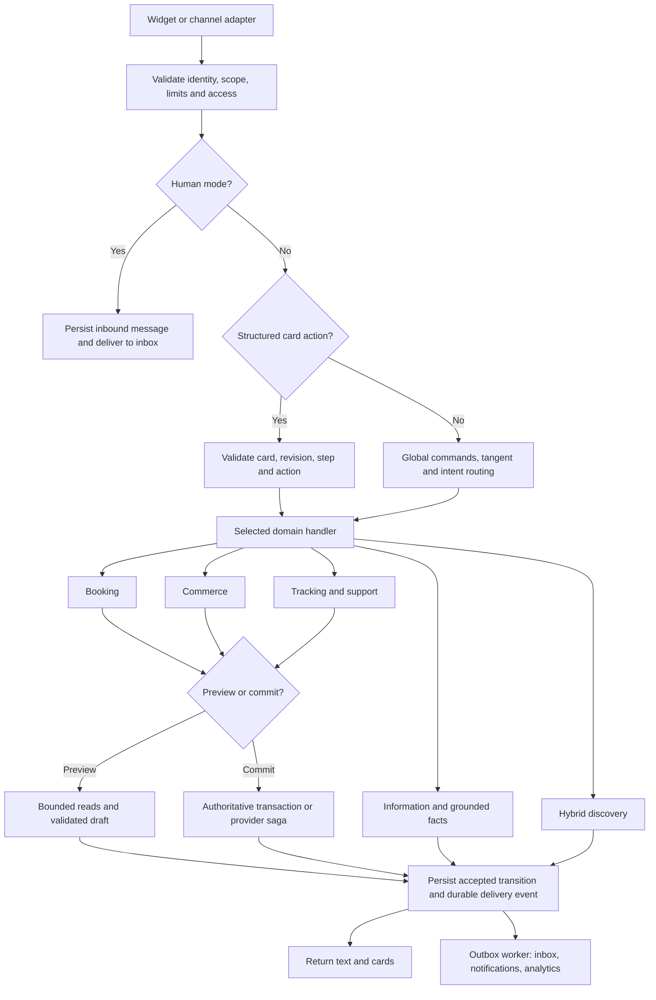

# Secure chatbot behaviour and speed: integration master plan

Status: phased implementation in progress. The secure structured-action fast path, request-local dependency reuse, bounded catalogue search, availability prefetch, local card drafts, parallel internal tracking reads and atomic batch inventory holds are implemented. The durable v2 envelope/outbox, shared quote service and external-provider saga remain later rollout phases described below.

Prepared: 24 October 2026. Applies to the existing multi-tenant product, embedded web widget, booking/restaurant flows, commerce, support, and channel adapters.

## 1. Source documents and precedence

This plan incorporates all three supplied documents:

1. `chatbot_customer_scenarios_response_playbook.md`: customer behaviour and text/card scenarios, IDs 1.1–7.3.
2. `chat_booking_commerce_speed_optimization-v2.md`: five intent lanes, lazy loading, session envelope, bounded catalogue and availability queries.
3. `blazing_fast_chatbot_concurrency_deferred_verification_blueprint.md`: concurrency, deferred work, local UI editing, and fast card dispatch.

The request also names `30-chat-booking_response_playbook.md`. That filename was not found in the inspected documentation; this plan treats the supplied customer scenarios playbook as the intended behavioural specification. The separate [current architecture and latency report](30-chat-booking-commerce-latency.md) remains the baseline, not the response playbook.

Examples in the supplied files are design proposals, not evidence that their RPC names, tables, timing claims, or guarantees exist in this repository. Existing explicit product requirements take precedence where they differ: downloadable booking receipts remain primary; do not replace them with Add to Calendar. Keep ticket cards free of the previously removed Check Status and Talk to Agent buttons. Offer handoff elsewhere when requested.

Implementation must preserve strict support bots, founder account restrictions and grace periods, tenant isolation, employee permissions, existing channel integrations, customer profiles, and existing ticket/booking/order records.

## 2. Decisions that adapt the blueprints safely

| Blueprint proposal | Integration decision |
|---|---|
| Five independent intent lanes | Adopt with one active transactional draft plus non-destructive informational side questions; mixed messages require clarification or an ordered plan |
| Route from client-supplied lane | Treat lane as a hint; validate it against the authenticated session and server-issued card action |
| Signed 60-second token replaces access checks | Do not adopt initially. Reuse the existing widget identity token; perform one fresh effective-entitlement lookup per request and reuse it internally |
| Unified Redis session envelope | Adopt behind a storage adapter, with revisions, CAS, separate flow expiries, bounded snapshots and a migration plan |
| Save flow state after responding | Reject. Required next-step state must be acknowledged before returning an accepted action |
| `after()` guarantees delivery | Reject that guarantee. Persist an outbox event before acknowledging; `after()` may wake a durable worker |
| Redis lock guarantees no duplicates | Use Redis only to reduce concurrent work. Database uniqueness, payload hashing and durable operation results establish idempotency |
| Sort an array then run holds through Promise.all | Reject as a transaction/lock-order guarantee. Lock sorted resources inside one SQL transaction |
| Decrement add-on inventory after booking | Include resource consumption and coupon redemption in the local booking transaction; do not return confirmed while required resources can still fail |
| Provider availability and local booking are one atomic operation | They cannot share a Postgres transaction. Use a reservation saga with pending status, idempotent provider attempts and reconciliation |
| Known phone/contact implies verified ownership | Reject. A supplied identity is a lead, not authentication; require verified ownership before private records or mutations |
| Cached availability is guaranteed | Display as a preview and revalidate on commit; provider outage must never imply that all slots are available |
| Allergen absence can be inferred from ingredients | Reject. Missing information means unknown; cross-contact and dietary certification require explicit sourced fields |
| Sub-200 ms and zero risk | Treat latency as a measured target. Do not claim zero risk, guaranteed speed, or an unmeasured conflict percentage |

## 3. Existing code and schema integration map

| Current component | Current role / limitation | Planned change |
|---|---|---|
| `src/app/api/chat/route.ts` | Shared setup, flow routing, knowledge retrieval, logging | Shared ingress plus selective text router; defer datasets until required |
| `src/app/api/chat/flow/route.ts` | Delegates to main chat POST | Dedicated authenticated action dispatcher |
| `src/lib/security/widgetSessionToken.ts` | HMAC token binds workspace, bot, optional session, purpose, expiry; up to three days | Reuse; require session binding for chat actions, strict claim validation and rotation support |
| `src/lib/saas/entitlements.ts` | Fresh `saas_entitlements` RPC; runtime/grace/human-support gates | Memoize only inside one request; preserve runtime policy |
| `src/lib/supportFlow.ts` | Strict-support gate and sequential domain dispatch | Preserve support gates; extract dispatch to shared router |
| `src/lib/bookingFlow.ts` | Redis state machine; repeated availability loads | Inject context/store/availability/quote dependencies; retain existing flow logic during migration |
| `src/lib/booking.ts` | Slot calculation, reservation RPC and calendar operations | Separate pure slot generation from reads; introduce transactional reservation wrapper and provider saga |
| `src/lib/commerceFlow.ts` | Broad catalogue load, local filtering, sequential holds | Scoped catalogue page repository, shared quote rules, atomic checkout |
| `src/lib/commerce.ts` | Holds, order placement and inventory domain operations | Keep facade; route upgraded commits to transactional SQL implementation |
| `src/lib/orderTrackingFlow.ts` | Internal-to-external lookup waterfall | Bounded parallel internal reads and verified disclosure |
| `src/lib/offeringDiscovery.ts` | Hybrid retrieval, up to 15 candidates, LLM selection, 300-second cache | Version cache keys, constrain candidates, refresh facts, allow streamed intro |
| `src/lib/calendarAdapters.ts` | Google Calendar, Calendly, Acuity, custom provider operations | Availability snapshots, capability-based commit strategy, reconciliation |
| `src/components/chat/ChatWidget.tsx` | Global loading and complete JSON cards | Per-card pending state, response revision checks, structured events |
| `src/components/chat/FlowMessage.tsx`, `AppleChatCards.tsx` | Existing interactive cards | Local drafts, fixed card IDs, discount badges, contextual actions, accessibility |
| `src/lib/interactiveReturnFlow.ts` | Existing flow message/interaction types | Introduce versioned common contracts through compatible adapters |
| `src/lib/customerContacts.ts` | Profile upsert/stitching | Invoke on explicit details submission/commit, separate claimed and verified identity |
| `src/lib/retention.ts` | Established history/flow/ticket durations | Use existing constants; maintain per-flow expiries in the envelope |

Actual schema names to use:

- Products: `catalog_products`, `catalog_product_availability`.
- Orders: `commerce_orders`, `commerce_order_items`; legacy `sales_orders` and mirrored `support_orders`/`support_order_items`.
- Booking: `booking_services`, `booking_offers`, `booking_offer_stats`, `feature_bookings`, `booking_table_assignments`, `booking_events`.
- Pricing: `coupons`, offer rules, and bot assignment tables including `bot_coupon_rules`.
- Inventory: `commerce_holds`, `inventory_movements`; existing booking add-on inventory migration `088`.
- Conversations: `sessions`, `messages`, `contacts`, `booking_flow_sessions`.

The source documents' `orders`, `product_offers`, `service_offers`, `place_order_atomic`, and `hold_cart_inventory_batch` are not assumed current. Adapt existing `place_catalog_order`, `hold_catalog_inventory`, `reserve_feature_booking`, `reserve_restaurant_booking` and `change_feature_booking` contracts. Review all later replacements before editing SQL functions.

## 4. Target execution architecture



Parallel waves are a scheduling strategy, not permission to run dependent operations concurrently:

1. Validate token locally, parse bounded input, start independent rate limits, session reads and fresh entitlement resolution after trusted scope is known.
2. Load only the selected lane's data. Run independent repository reads together with deadlines and concurrency limits.
3. Compute response; persist accepted state and durable event. Commit requests use the authoritative domain transaction.
4. Return. Deliver inbox notifications and analytics from the outbox.

An origin is an embedding policy signal, not an identity credential. Do not begin tenant reads using unverified request IDs. Requests in human/waiting mode must not trigger autonomous commerce or booking actions.

## 5. Behaviour contract: routing precedence

The following order applies to free text before a flow-specific field validator:

1. Account/bot policy and human-handoff mode.
2. Explicit human-help request.
3. Global Back, stop-current-draft, resume and explicit lane switch.
4. Existing-record management: cancel/change order or booking, track, return, refund.
5. Informational side question about a product, policy, ingredient or service.
6. Valid expected input for the active step.
7. New explicit booking or purchase intent; discovery if recommendation language is detected.
8. Grounded general information or a short disambiguation question.

Never interpret “cancel my order” as a new purchase or “book a table” as a product query. Never interpret a complete booking sentence as the customer's name. A question mark alone does not identify a tangent. Use semantic categories, expected step and entity recognition; ambiguous input asks a specific clarification.

One active transactional lane prevents simultaneous state corruption. It must not trap a customer in a phone/date validator. If a message asks both for a booking and an order, acknowledge both, ask which to finish first or execute only the unambiguous non-mutating part; never silently create two transactions.

An informational request does not itself pin a checkout. Clicking a valid Add/Book action starts the corresponding draft. Strict support bots do not expose booking/purchase actions even when an item is mentioned; they can show read-only order/product facts needed to resolve support.

## 6. Complete scenario-to-response implementation matrix

The IDs below map directly to the supplied playbook. Wording is illustrative; factual values must be supplied by the stated source.

| ID | Trigger | Execution and truth source | Required response and state behaviour |
|---|---|---|---|
| 1.1 | Price/discount of a named item or service | Exact scoped entity lookup; authoritative current pricing/availability | “Lamp A is INR …”; product/service card with valid discount, variant and permitted action. No LLM necessary |
| 1.2 | Benefits/how-to | Entity row and linked item knowledge in parallel; stream grounded summary | Short explanation plus actionable card; do not invent medical results or timelines from example copy |
| 1.3 | Ingredients/combo/allergens | Structured sourced fields and item-specific knowledge | Contents/allergen explanation plus dish card. Explicit present/absent/unknown and separately cross-contact; no inferred certification |
| 1.4 | Compare A and B | Batch scoped lookup, linked chunks, bounded LLM comparison | Two-card carousel and concise comparison; ask clarification if either entity is ambiguous |
| 1.5 | Sold-out/discontinued item | Availability and existing waitlist capability | Disabled purchase, configured waitlist action and up to three eligible alternatives; do not offer a nonexistent restock programme |
| 2.1 | Gift/goal/budget recommendation | Scoped hybrid RRF, maximum 15 candidates, LLM selects up to five | Warm relevant introduction followed by cards; apply hard budget/category constraints before model ranking |
| 2.2 | Offers/menu/specials | Existing offer stats, coupons and assigned catalogue/services | Offers carousel with real conditions. “Bestseller” needs actual ranking data; no fabricated popularity |
| 3.1 | Buy lamp / SKU / category | Indexed bounded product search | Matching carousel, local quantities, bottom Proceed. If missing, say no match and suggest narrowing; never show unrelated Test1 |
| 3.2 | Two pizzas and one drink | Parse quantities, batch resolve entities and required variants | Draft cart containing unambiguous items; variant picker for unresolved lines; no default variant or unwanted substitution |
| 3.3 | Quantity/variant/cart edit | Local draft; server validation on Update/Proceed | Immediate local update, selected control stays highlighted; no redundant right-side text bubble |
| 3.4 | Apply coupon | Shared quote engine, scope/minimum/expiry/stackability rules | Inline valid/invalid/minimum-gap response, eligible suggestions, preserve cart; final redemption remains transactional |
| 3.5 | Confirm order | Fresh access, identity/details validation, atomic price/stock/coupon/order operation | Persisted order receipt; on conflict show exact revised availability and require new customer acceptance |
| 4.1 | Book table/appointment | Assigned services and configured locations | Location buttons, not free text when branches exist; auto-select only a unique valid option; ask only missing required fields |
| 4.2 | Branch/date/time/party supplied | Deterministic extraction and bounded availability lookup | Prefill matching slot, skip already answered pickers; still offer add-ons/note, obtain required details, show review before confirmation |
| 4.3 | Requested slot full | Same availability snapshot, nearest matching slots | Explain unavailability with same-day alternatives; selected date and party size remain intact |
| 4.4 | Confirm/reschedule/cancel booking | Verified management and atomic local reservation/provider saga | Confirmed receipt only after required success; downloadable receipt; cancellation says “Reservation cancelled” without internal inventory details |
| 5.1 | Tracking with reference | Parallel native/legacy/support reads; ownership gate | Verified tracking card; do not disclose items or address merely because a reference is valid |
| 5.2 | Tracking without reference | Verified customer scope, otherwise lookup form | Show recent orders only for verified principal; otherwise ask order ID and verification. A previously typed phone is insufficient |
| 5.3 | Return/refund/ticket/human | Existing order resolver and return flow, scoped eligibility, handoff policy | Verification, remaining eligible items/quantities, reason, damage evidence when configured, resolution, review, persisted ticket; ticket card plus configured CSAT |
| 6.1 | Policy/hours/delivery FAQ | Exact/cache then linked knowledge, streaming | Grounded concise answer; delivery eligibility uses structured rules if available |
| 6.2 | Missing business information | No authoritative support found | Say the detail is unavailable and offer configured team/ticket route; preserve active draft |
| 7.1 | Question during checkout/booking | Read-only fact/knowledge handler | Answer plus Resume action/current card; retain selections, note, quote and flow revision |
| 7.2 | Explicit switch/abandon draft | Atomic lane transition, bounded archive and hold release | Acknowledge switch and open new lane. Abandoning a draft never cancels an already confirmed booking/order |
| 7.3 | Double confirm/retry | Durable operation ID, payload hash, unique constraint | Same committed receipt; if pending, return processing with status lookup; never fabricate success or create duplicate records |

Additional required regressions from the existing product:

- Damage evidence uploads must reach the ticket record/dashboard. Signed media references must be scoped to the session and verified order.
- A single-item order with an existing return shows its ticket. Multi-item orders offer only remaining eligible quantities, calculated from committed return records.
- Details cards require name/phone and commerce address/pincode; email follows existing optional requirements.
- Selected add-ons must survive preview, Back, quote, confirmation and receipt, including service duration and product quantities.
- “No thanks” records an explicit empty note/add-on choice; it must not overwrite a nonempty selection accidentally.
- No configured booking price means unknown bill, not a zero-value bill. Show “30% off the eligible bill” or “INR 500 off, subject to …”; do not invent a monetary saving.
- Grace-period behaviour follows runtime entitlements independently of dashboard write restrictions and human-support permission.

## 7. Unified session and concurrency contract

Proposed server shape; reuse the current domain payloads behind adapters before redesigning them:

```ts
type Lane = 'BOOKING' | 'COMMERCE' | 'SUPPORT' | 'TRACKING';
type SessionEnvelopeV2 = {
  schemaVersion: 2;
  clientId: string; botId: string; sessionId: string;
  revision: number;
  mode: 'ai' | 'waiting' | 'human';
  activeLane: Lane | null;
  activeFlowId: string | null;
  stepId: string | null;
  flows: Partial<Record<Lane, {
    flowId: string; expiresAt: number; payload: unknown;
  }>>;
  verifiedIdentityRef?: string;
  quoteId?: string;
  updatedAt: number;
};
```

Information and discovery are execution routes, not additional durable transaction drafts. A tangent never changes activeLane unless the customer chooses a new action.

Redis key: `chat:v2:{clientId:botId:sessionId}:envelope`. Use hash tags consistently if multi-key Lua operations need Redis Cluster colocation. Do not key sensitive state using session ID alone.

Every mutating action carries expectedRevision and an actionId. CAS checks the revision, verifies the expected flow/step, updates the state and revision exactly once. A conflicting action returns 409 with the current card, not a blind overwrite. A short lock is only an efficiency tool; use owner tokens and bounded leases, and never hold it through LLM generation.

Previews are read-only and do not advance the revision or append a new conversation turn. Different previews can run concurrently. Accepted actions serialize per session; cancellation waits for/reconciles an in-flight confirmation instead of assuming it did not commit.

Draft caps, initially: 50 cart lines, 20 back-history snapshots, 64 KiB envelope, 200 characters per search query. Store media references, not binary payloads. These are proposed adjustable limits; validate them with real usage before release.

Expiry rules reuse `retention.ts`: widget history three days, unfinished returns three days, unfinished bookings/orders 24 hours, holds 15 minutes where applicable. Do not extend one flow's expiry just because another is active. Transcript default 30 days with existing 3/30/90 workspace options; ticket retention 365 days. Final transaction records follow their separate retention rules.

## 8. API contracts and card capabilities

Keep the existing `/api/chat` and `/api/chat/flow` URLs. Introduce protocolVersion 2 without breaking version 1 clients.

```ts
type FlowActionRequest = {
  protocolVersion: 2;
  actionId: string;
  flowId: string;
  stepId: string;
  expectedRevision: number;
  cardId: string;
  action: string; // validated against the server action union
  input: unknown; // discriminated schema per action
  capability: string;
};
type FlowActionResponse = {
  protocolVersion: 2;
  requestId: string;
  actionId: string;
  revision: number;
  messages: unknown[]; // versioned existing FlowMessage adapters
  replaceCardId?: string;
  operation?: { id: string; status: 'pending' | 'succeeded' | 'failed' };
};
```

Validate with the project's installed Zod or equivalent explicit shared schemas. Reject oversized bodies, unknown actions, unexpected fields and invalid quantity bounds.

The existing widget token authenticates the session. A proposed short-lived signed card capability additionally binds client, bot, session, flow, step, card, permitted actions, revision, issue/expiry time and key ID. It contains no customer PII and no authoritative price. Sign server-side, compare signatures safely, renew expired capabilities after rehydration. Token theft remains a concern: TLS, no token logging, private responses and XSS-safe rendering are required.

Server checks both token and current state. A forged lane or valid capability for an old step does not authorize an action. Stable capabilities may identify a durable confirmation operation even after the flow is completed; replay returns the existing result after session/ownership checks.

Preview action examples: `preview_availability`, `search_catalog`, `load_catalog_page`. They never commit flow selections. Accepted actions: `select_service`, `proceed_schedule`, `update_cart`, `apply_coupon`, `submit_details`, `confirm_booking`, `confirm_order`, `resume`, `back`, `cancel_draft`. Existing-record cancellations use separate explicit actions after verification.

Status codes: 400 validation, 401 expired/invalid identity, 403 policy/ownership, 409 stale revision or changed quote/stock, 422 valid syntax but invalid business choice, 429 rate limit, 503 temporary dependency failure. Responses expose safe customer messages and a requestId, not SQL errors or stack traces.

## 9. Security and access enforcement

One `ChatRequestContext` owns memoized promises for entitlements, session, booking configuration, commerce configuration and availability. It is created anew for each request, never module-global.

Every request evaluates bot runtime availability and the selected feature against the existing effective entitlements, including grace deadlines. Handoff uses humanSupportAllowed separately. Authoritative commit RPCs recheck the relevant account/feature state or validated policy version within their transaction so a concurrent shutdown cannot rely solely on an earlier application read.

Keep the existing limiter semantics and fallback policy; do not replace them with unexpired INCR keys. A pipeline reduces transport overhead but is not an atomic limiter. Enforce per-IP, tenant/session, action and verification-attempt budgets; derive client IP only from trusted proxy headers.

Identity verification is separate from contact capture. Private tracking, booking/order management and return eligibility require a scoped verified proof: authenticated customer session, OTP challenge, or short-lived signed management capability. Matching order ID plus contact details may support a low-assurance workflow only under an explicit workspace policy; never treat stored contact metadata alone as proof. Verification errors should avoid revealing whether an order exists.

Database RPCs require explicit tenant checks, bounded inputs, parameterized queries, restrictive execute grants and fixed search_path for privileged functions. Service-role access bypasses RLS; handlers must prove scope, and functions must enforce foreign-record ownership. Do not accept browser-supplied client IDs as authority.

Tenant/bot assignment restrictions apply to every product, service, offer and coupon, including discovery candidates and final commit. Render only permitted card fields. Credentials remain in workspace integrations, server-only and encrypted using the existing secret-storage approach. Custom connectors use the existing safe outbound fetch policy and bounded response sizes/timeouts.

## 10. Booking window and restaurant algorithm

1. Resolve permitted service and branch. If service determines valid branches, choose service first; do not present impossible branch/service combinations.
2. Load versioned service configuration once: IANA timezone, working hours, holidays, notice, duration, buffers, tables, staff, add-ons and slot limits.
3. Build a bounded seven-local-day UTC interval with overlap padding covering duration/buffers and DST.
4. Query confirmed/pending-reserved occupancy and table/staff assignments in bounded parallel reads or one RPC. One network RPC may contain multiple SQL queries; do not claim all capacity modes are one simple table query.
5. Read provider busy snapshot with fetchedAt and freshness state.
6. Generate slots once per configuration/window. Allocate table combinations for the actual party size; count both available seats and valid table combinations.
7. Apply configured offers by local weekday/time, branch, service, party size and capacity.
8. Return first three days of usable slot details and seven-day availability summaries. Load more only when expanded/requested.

Memoization/cache keys include tenant, bot, service, location, staff, date window, timezone, duration-affecting add-ons, party size, configuration version, inventory/occupancy version and offer version. A party-size change cannot reuse availability for the prior party size unless recalculated from raw occupancy.

Preview cache TTL target: 15–30 seconds; provider busy snapshot target: up to 60 seconds when integration policy permits. Expiry is a ceiling, not permission to assert freshness. Explicit current-availability questions refresh or disclose uncertainty. Scheduling edits invalidate cache versions. Cancel/reschedule/create and provider events invalidate occupancy.

Date, party size and selected time stay local until Proceed. A changed date clears an incompatible slot. While an uncached preview is loading, show a slot skeleton inside the existing card and discard stale responses by preview request ID. Do not accept Proceed until a valid matching date/party/slot snapshot is present.

Slot tiles show time and the applicable configured percentage/flat label below it. The offer claim card precedes contact/review, and the receipt uses the same quote breakdown. Never show raw table allocations, customer lists or staff occupancy data in public payloads.

## 11. Commerce search and recommendations

Proposed `search_bot_catalog_page` RPC joins bot assignments and applies tenant, status, normalized query, category and SKU filters in SQL. Initial page eight, first visible four/five, hard page maximum 20. Stable keyset ordering includes a unique ID tie-breaker; sign/validate cursors and bind them to tenant, bot, query and catalogue version. Changing search resets the cursor.

Return only card fields and valid variants; do not return internal cost or supplier metadata. Use indexed exact SKU/name lookup before broader text/trigram search. Add indexes after EXPLAIN on representative datasets; avoid assuming wildcard ILIKE is indexed. Zero matches produces a no-match response, not a generic catalogue.

Multi-item input resolves all names in one bounded wave. Preserve clear matches while asking about ambiguous names or required variants. An LLM may assist ambiguous extraction with schema validation but cannot silently mutate the cart from untrusted output.

Hybrid discovery retains the existing RRF candidate RPC and maximum 15 candidates. At most five cards emerge from validated model-selected IDs. Cache IDs and short reasons, not stale authoritative prices. Cache keys include workspace, bot, normalized request, locale, currency/budget, assignment/catalogue/offer versions and model/prompt version. Rehydrate authoritative public fields on a cache hit.

Product facts and knowledge retrieval may run concurrently for benefits/comparison. Exact monetary/stock/discount facts are server-formatted and not generated by the LLM. Revalidate hard budget and bot scope after model output. Missing ingredient/certification data stays unknown.

## 12. Shared pricing, coupon and upsell engine

Create one quote service consumed by cards, review and commit adapters. Input is IDs, quantities, variants, service/slot/branch and proposed coupon—not prices from the browser.

Quote result includes quoteId, fingerprint, issuedAt, expiresAt, currency, subtotal, item/add-on lines, applied discounts, rejected-discount reasons, tax/fee rules if configured, total and eligibility conditions. Use database numeric/minor-unit arithmetic appropriate to currency; define rounding order explicitly and share golden fixtures with the frontend preview.

Evaluate active interval, local slot rule, selected scope, minimum spend, maximum uses, customer limit, offer quota and stacking compatibility. A coupon cannot accidentally apply to an excluded item. Default to no stacking unless the configured compatibility permits it. Record the exact applied rules and amounts on the committed record.

For upsell, compute the gap to the next actually eligible threshold and offer at most a few eligible additions. Do not promise an expired or exhausted discount. Claiming a coupon marks a selection, not a usage redemption. Usage increments inside the final transaction.

For unknown restaurant bill totals, use a deferred benefit with scope, expiry, cap/minimum and identity binding. Receipt says “30% off eligible bill” rather than a fictitious discount amount. Later redemption verifies the real bill and consumes the benefit once. An unverified last-ten-phone-digit hash must not authorize benefit transfer or redemption.

## 13. Atomic commits and durable idempotency

Introduce a durable operation record scoped by tenant, bot, session and operation type. Unique operation key plus canonical request hash prevents reuse with different contents. The operation is issued for a reviewed flow revision; changed cart/quote requires a new reviewed operation.

For local commerce commit, one SQL transaction:

1. Resolve/recheck policy and claim the operation identity.
2. Lock inventory rows in deterministic ID order and applicable coupon/offer quota rows in a documented global order.
3. Validate assignments, required variants, live stock, existing hold ownership/expiry, prices and quote acceptance.
4. Reject conflicts with structured item/quote changes; no partial consumption.
5. Insert order and lines, consume stock/holds, record inventory movements and coupon usage.
6. Link verified/claimed customer data appropriately, write durable receipt result and outbox event, commit.

Booking commit similarly includes table/staff capacity, slot limits, service duration/add-ons, product add-on stock, offers and coupon usage in one local transaction. Refactor `claim_booking_addon_inventory` so required resources are not an independent post-success failure point.

Redis locks do not establish business uniqueness. On repeat action, read the durable operation: completed returns the same receipt; pending returns status; payload mismatch returns conflict. A timeout after commit is recovered by operation lookup, never by placing another order. Retain the unique operation marker for the domain record lifetime even if cached response bodies expire.

Hold policy: no hold on every quantity click. Existing 15-minute checkout holds remain supported; acquire/renew in a batch only at an explicit checkout/hold boundary if that bot's policy requires it. Otherwise confirm directly with atomic inventory consumption. Release on explicit abandonment/expiry using idempotent workers. Do not silently remove existing hold promises during rollout.

## 14. External calendar commit saga

Postgres and calendar providers do not share a transaction. Do not claim that a live free/busy check alone prevents an external edit racing with booking creation.

Proposed states: `pending_external`, `confirmed`, `external_uncertain`, `failed`, `cancel_pending`, `cancelled`.

1. Fresh policy and local atomic provisional allocation with operation ID and expiry.
2. Query provider availability and request creation using a provider idempotency key/external correlation marker where supported.
3. On verified success, finalize booking and related resources; return confirmed receipt.
4. On known rejection, compensate the provisional allocation and return alternatives.
5. On network timeout/unknown outcome, mark external_uncertain and reconcile provider state before retry/release. Do not release local inventory while a potentially valid external booking remains unexplained.

A periodic worker plus provider webhooks reconcile stranded operations. Reschedule reserves the replacement and coordinates provider change before releasing the original allocation; partial failure preserves/reconciles the original. Cancel is idempotent and is not displayed as complete while a required provider cancellation is still uncertain.

The UI can return “We’re checking your reservation” promptly with an operation-status card. Provider completion time is a separate metric from response time. Capability differences for Calendly/Acuity/Google/custom adapters must be reflected; do not promise unsupported in-chat rescheduling.

## 15. Durable state and outbox delivery

For the initial secure implementation, introduce one durable accepted-action append operation in Postgres. It records the event, expected/new revision and a bounded recovery snapshot before the server acknowledges a changed draft. Redis is the fast hydrated projection. If a crash occurs after the database append but before Redis update, reload the recorded revision/result; do not replay the action blindly.

Read-only previews need no transcript write. Accepted selections generate one structured event, not an additional visible user text message. Final domain transactions write their operation result and outbox event in the same transaction as the booking/order.

Proposed outbox fields: id, client_id, session_id, event_id, sequence, event_type, aggregate_id, payload, created_at, available_at, attempt_count, lease_until, completed_at, last_error_code. Unique event_id and idempotent consumer inserts prevent duplicate messages/notifications.

Worker order: persist conversation projection, then broadcast canonical message IDs, then notifications/analytics. Use bounded leases, retry with jitter, maximum attempts and a dead-letter state with operator visibility. Per-session sequence numbers support ordered replay and inbox sync after disconnect. Workers authenticate, verify job signatures if using existing QStash, and enforce tenant scope.

`after()` may dispatch a wake-up but is not the durable queue. Worker startup/crash or missing wake-up is recovered by scheduled polling of pending outbox rows. This intentionally retains one durability round trip; do not advertise zero-cost persistence.

LLM streaming has a distinct contract: persist turn acceptance before streaming; persist final response when complete, mark interrupted responses if generation stops, and do not repeat tool mutations on reconnect. Periodic bounded checkpoints are optional if the product requires recovery of partial text.

## 16. Frontend and channel integration

Reuse existing card components and their styling. Introduce stable cardId, actionId and revision fields through adapters. Maintain `draftByCardId`, `pendingByCardId`, and the latest accepted server revision in the widget.

- Product quantities, variants and add-ons update locally; buttons, price and descriptions retain consistent alignment.
- Scheduler date/party controls update local preview state. Proceed is the only selection commit.
- Use per-card skeletons, keyboard focus, clear disabled state and reduced-motion support.
- Optimistic controls indicate selection, not transaction success. Failed requests preserve drafts and expose Retry/Back.
- Tangent responses attach Resume to the existing flow; do not resurrect expired capabilities or duplicate the calendar.
- Cancel/Back remain available in name/phone steps and are routed before field validation.
- Contextual coupon cards show eligibility and claim state; final receipts show subtotal, discounts and total or explicitly deferred benefit.
- Keep browser data bounded and erase session drafts on expiry or identity change. No access tokens in URLs or logs; private/no-store for personalized endpoints.

For fact-plus-card streaming, add versioned events: `response_start`, `text_delta`, `card_upsert`, `flow_state`, `response_done`, `response_error`, each with request/sequence IDs. Client can accept current JSON when streaming is unsupported. A neutral acknowledgement may precede slow retrieval; never claim a product/slot exists before validation.

Website, WhatsApp, Telegram and other channel adapters call the same domain dispatcher. Web receives rich cards; channels receive supported lists/buttons/text with short server-resolved action IDs. Verify channel webhook signatures and deduplicate provider event IDs. Do not promise that the web calendar/carousel renders identically in external channels. Fallback text replies must carry the same state revision and identity requirements.

## 17. Cache, RAM and invalidation design

| Data | Proposed policy | Invalidation / safety |
|---|---|---|
| Effective access | Request-only memoization | Fresh every request; commit rechecks policy |
| Bot/service/catalogue metadata | Redis 60–300 seconds, versioned | Dashboard assignment/config edit increments version |
| Catalogue search page | 15–30 seconds, bounded results | Product/status/price/assignment version; explicit factual pricing reads refresh |
| Availability window | 15–30 seconds | Booking/table/staff/schedule/provider changes; full dimensions in key |
| Provider busy snapshot | Up to 60 seconds under configured freshness policy | Webhook/refresh; stale marked unknown, commit authoritative |
| Offers/coupons | Up to 60 seconds, bounded by next expiry | Rule/version changes; consumption rechecked transactionally |
| Recommendation IDs/reasons | 300 seconds | Assignment/catalogue/prompt version; refresh current facts |
| Session projection | Individual flow expiry | Revision-based CAS, durable recovery |

Prefer existing Redis, Supabase and queue dependencies; no new service is mandatory. If adding an in-process LRU, cap it by bytes and entries, avoid customer PII, and monitor eviction. Do not preload all tenant catalogues or unbounded seven-day matrices for every possible party size. Limit speculative prefetch to the visible card and cancel obsolete work. Deduplicate identical cache fills and enforce per-tenant work limits so one large catalogue cannot monopolize RAM/connections.

## 18. Proposed file and migration work packages

Paths below are proposed unless listed as current in section 3:

| Work package | Files / scope | Completion criterion |
|---|---|---|
| P0 baseline | `src/lib/chat/timing.ts`, current routes/widget | Request ID, stage timings, p50/p95/p99 and SQL/Redis call counts |
| P1 context | `src/lib/chat/requestContext.ts`, entitlements/config helpers | One request-scoped authorization result; no unrelated dataset hydration |
| P2 contracts | `src/lib/chat/contracts.ts`, `security/flowCapability.ts` | Versioned schemas, action authorization, stale-card handling |
| P3 state | `src/lib/chat/sessionStore.ts`, `legacyFlowAdapter.ts` | CAS, expiry, migration and durable transition recovery |
| P4 routing | `src/lib/chat/router.ts`, `lanes/*`, both chat routes | Global commands/tangents work; validated direct action dispatch |
| P5 catalogue | `src/lib/chat/catalogRepository.ts`, commerce/discovery | SQL filtering, pagination, exact matches, facts + cards |
| P6 scheduling | `src/lib/chat/availabilityRepository.ts`, booking files | One bounded window load, result reuse, preview isolation |
| P7 pricing | `src/lib/chat/quoteService.ts`, booking/commerce adapters | Consistent coupon/offer/receipt outcomes and deferred bill benefits |
| P8 transactions | booking/commerce SQL wrappers, operation repository | Atomic stock/capacity/coupon/add-ons and durable idempotency |
| P9 providers | calendar adapter facade + reconciliation worker | Pending/uncertain/cancel/reschedule recovery |
| P10 delivery | outbox repository, authenticated worker/cron route | Durable messages, ordered realtime and deduplicated notifications |
| P11 UI | current widget, flow renderer, Apple cards | Local drafts, per-card loading, stable updates and structured streaming |
| P12 validation | existing flow/DB tests plus integration scenarios | Behaviour matrix and security/load gates pass |

Allocate migration numbers from the next available number at implementation time, not hardcoded 089. Suggested separate migrations:

1. Protocol operation/event/outbox tables, indexes, RLS and execute grants.
2. Catalogue search RPC/indexes and configuration-version support.
3. Availability range RPC/provider busy snapshot support.
4. Quote/redemption constraints and atomic order/booking wrappers.
5. Provider saga states, recovery indexes and worker leasing support.

Make migrations rerunnable where appropriate, but do not let IF NOT EXISTS hide incompatible columns or constraints. Add explicit schema assertions and backfills. Review existing triggers so inventory restoration, coupon use and notifications do not execute twice. Use a capability/version check at deployment rather than a storage probe on every customer message.

## 19. Rollout, compatibility and rollback

1. Record baseline timings using representative warm/cold flows. Add golden behaviour tests first.
2. Ship instrumentation and request memoization with no routing changes.
3. Add durable operations/outbox and state compatibility adapters; test failure recovery before removing synchronous delivery.
4. Enable v2 on internal test bots. Shadow only read-only intent/quote decisions; never shadow transactions or send duplicate customer messages.
5. Route new v2 sessions through the dedicated dispatcher. Existing v1 sessions stay on their original handler until expiry or an explicit locked migration.
6. Enable bounded catalogue and availability reads, then new frontend drafts and streaming.
7. Enable new atomic commit wrappers after real Postgres concurrency tests.
8. Canary by workspace/bot using proposed flags `chat_protocol_v2`, `chat_lane_router_v2`, `chat_window_availability`, `chat_catalog_pages`, `chat_quote_v2`, `chat_durable_delivery`.
9. Expand when behaviour and latency/error gates pass; remove legacy adapters only after all legacy sessions expire and migrations are verified.

Migration is single-owner: never allow both legacy and v2 writers for one session. A locked importer reads the legacy booking/commerce/return keys, resolves the active flow by explicit metadata or asks the customer to resume one if ambiguous, writes the envelope and ownership marker, then switches routing. Avoid indefinite dual writes.

Rollback flags affect new sessions or route existing v2 sessions to a compatible v2 reader. Do not send a new envelope to old code that cannot read it. Database migrations remain additive; preserve committed orders, bookings, coupons and outbox events. A provider-uncertain operation stays under reconciliation even after feature rollback.

## 20. Measurement and performance goals

All targets below are proposed, not measured promises. Measure in production-like deployment regions with realistic tenants, datasets, concurrent sessions and configured providers. Do not add the source documents' projected savings together.

| Path | Initial target | Measurement boundary |
|---|---|---|
| Local quantity/date change with already valid cached data | Within a rendering frame where practical | Input-to-paint; no claim of literal 0 ms |
| Preview/simple accepted card action | p95 300–500 ms | Server request-to-response including required durability |
| Indexed product search | p95 350–600 ms | Full card response at bounded page size |
| Native booking/order commit | p95 800–1,500 ms | Durable committed result |
| Cold recommendation | p95 1.5–3 seconds, early safe acknowledgement | Separate first token, cards ready and full response |
| External provider operation | Prompt pending response; measure provider completion separately | Do not fold pending acknowledgement into confirmed-booking SLO |

Record auth, Redis, lane routing, configuration, catalogue, quote, availability DB/CPU, provider, embedding, retrieval, LLM TTFT, commit, durable append, broadcast lag and browser card paint. Use low-cardinality metrics by lane/action/result; tenant/request IDs belong in access-controlled traces, not unbounded metrics labels. Never log tokens, full addresses, evidence images or OTPs.

Test a staged load ramp against seeded nonproduction tenants, for example 10, 50 and 100 concurrent sessions with realistic think time and cache misses. Watch memory, event-loop lag, DB connections/locks, Redis limits, outbox lag and error rate. Adjust capacity targets based on measured infrastructure, not the proposed matrix.

## 21. Acceptance and security test plan

Extend existing `test-booking-flow.cjs`, `test-commerce-flow.cjs`, `test-order-tracking-flow.cjs`, `test-offering-discovery.cjs`, `test-restaurant-booking.cjs`, `test-booking-addon-inventory.mjs`, SaaS tests and database integration scripts. Mock-based durations are not latency evidence.

Required test groups:

1. Every scenario ID 1.1–7.3: correct route, answer/card pair, data source and preserved state.
2. Cross-tenant/bot IDs, forged lane, tampered capability, wrong session, expired token, old step and replay with changed payload all fail safely.
3. Shutdown or feature removal between preview and commit blocks new action; grace-period bot/human permissions follow actual policy.
4. Supplied phone or contact ID cannot reveal orders; verified proof is resource/tenant scoped and expires.
5. Two customers contend for the last stock unit/table/coupon use/add-on: one valid allocation, no negative stock or partial booking.
6. Same customer double-clicks, uses two tabs, retries after timeout or changes cart during confirmation: no duplicate or stale overwrite.
7. Crash after commit before response returns the persisted receipt on retry; crash after event append before Redis update restores current state.
8. Outbox duplicate delivery, worker lease expiry, process termination before after(), and realtime disconnect recover without duplicate UI messages.
9. Provider timeout after successful external create, webhook duplication, failed compensation and conflicting external edit enter correct reconciliation states.
10. Calendar DST gap/repeated hour, midnight, leap day, service timezone, buffers, staff overlap, combined tables and party changes produce valid slots.
11. Discount expiry, scope, minimum, quota, per-customer limit, compatible/incompatible stacking, unknown restaurant total and currency rounding match receipt/commit.
12. Malicious knowledge text cannot invoke mutations or leak tenant data; unknown/allergen information is not asserted as safe.
13. Slow preview response cannot replace a newer date selection; screen-reader and keyboard interaction remain usable.
14. WhatsApp/Telegram replay and unsupported card fallback preserve server action authorization and flow continuity.
15. Contact capture survives explicit details submission; marketing consent is never inferred from booking/purchase alone.

Release gates: no cross-tenant disclosure, no duplicate committed resources in concurrency tests, all required scenario assertions pass, bounded memory under load, durable recovery demonstrated, measured improvement without increased failure rate, and operations staff can inspect failed jobs/provider uncertainty.

## 22. Implementation priorities and deliverables

Priority 0: preserve identity/access/idempotency, define behavioural fixtures, measure current latency.

Priority 1: request memoization, lazy knowledge loading, read parallelism, bounded catalogue queries and availability reuse.

Priority 2: durable state/outbox foundation, dedicated action endpoint, capability/revision checks and per-card frontend drafts.

Priority 3: shared quote engine, complete fact-plus-card/tangent behaviour, strict transaction wrappers and provider reconciliation.

Priority 4: structured streaming, channel parity, canary rollout and performance tuning from traces.

Each work package must deliver code, migration where needed, failure-path tests, operational metrics, rollback notes and a code-to-playbook scenario checklist. Do not mark the overall work complete merely because TypeScript compiles or mocked flow tests pass; actual database concurrency and provider staging tests are separate required evidence.

## 23. Technical references used to validate design corrections

- Next.js documents that `after()` runs after response completion and is bounded by the route's execution duration. The durable-outbox decision above is our reliability design, not a guarantee supplied by `after()`: [Next.js after reference](https://nextjs.org/docs/app/api-reference/functions/after).
- Redis pipelining batches commands to reduce round trips. Read-modify-write coordination needs an appropriate atomic mechanism rather than assuming a pipeline is a transaction: [Redis pipelining](https://redis.io/docs/latest/develop/using-commands/pipelining/).
- PostgreSQL documents row locks and consistent lock acquisition as tools for concurrency control; the proposed batch transactions adopt a global lock order: [PostgreSQL explicit locking](https://www.postgresql.org/docs/current/explicit-locking.html).

Repository package versions observed: Next.js 15.5.28, installed Upstash Redis/rate-limit/QStash dependencies, and Zod. Verify deployment runtime and provider capabilities against those versions during implementation; the external references do not authorize a framework upgrade.

## 24. Implemented foundation (25 October 2026)

The first production-safe phase now maps to concrete code:

- `src/app/api/chat/flow/route.ts` is a dedicated, token-bound structured action endpoint with strict Zod input validation, rate limiting, fresh runtime access checks, human-mode protection and direct domain dispatch.
- `src/lib/chat/requestContext.ts` deduplicates entitlements, bot configuration and availability work only within one request and emits `Server-Timing` stages.
- `src/lib/chat/contracts.ts` rejects unknown outer/action fields, oversized identifiers and mismatched flow/step identities.
- `src/lib/chat/persistFlowTurn.ts` durably writes accepted assistant cards and updates the selected prior card without creating a duplicate customer text bubble; realtime/cache fan-out is non-authoritative.
- `src/lib/chat/catalogRepository.ts` and migration `090_bounded_bot_catalog_search.sql` replace whole-catalogue reads with a maximum-50, tenant/bot-scoped search. A bounded legacy fallback exists only for rolling deployments where migration 090 is not installed.
- `src/lib/bookingFlow.ts` reuses one availability result per request and prefetches three visible days concurrently. Scheduler date/party controls remain local until Proceed, when the server validates the submitted combination.
- `src/lib/commerce.ts` and migration `089_chat_fast_path_and_batch_holds.sql` acquire multiple product holds through one sorted database transaction, with a compatibility fallback while the migration rolls out.
- `src/lib/orderTrackingFlow.ts` performs independent native, legacy and support-store lookups concurrently while retaining identity verification.
- `ChatWidget.tsx` uses per-card pending state; `AppleChatCards.tsx` keeps calendar and party edits local; selected actions update the source card rather than adding a redundant right-side bubble.
- `scripts/test-chat-fast-path.cjs` covers request-local deduplication and strict action scope validation. Existing booking, commerce, tracking, discovery, restaurant allocation, add-on inventory, notification and transport tests remain in the full suite.

Database migrations 089 and 090 must be applied before relying on the batch-hold and bounded-search paths in production. The application deliberately retains compatibility fallbacks during a rolling deployment, but those fallbacks are not the target steady state.
