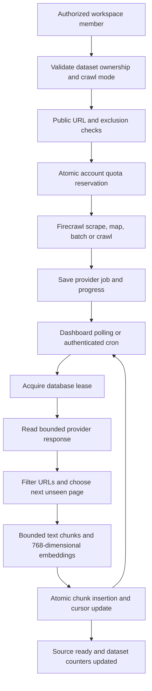

# Knowledge-base purpose and controlled website imports

## Setup

Apply `supabase/105_knowledge_crawl_guardrails.sql` after the existing SaaS and knowledge migrations. It is re-runnable, adds saved crawl progress and leases to `dataset_sources`, backfills limits into existing plan versions without overwriting previously configured values, and creates service-role-only reservation and ingestion functions. No additional queue, package, or always-running process is required.

Set `FIRECRAWL_API_KEY` and the existing embedding/Supabase credentials on the server. Never expose the Firecrawl key in a browser environment variable. Local development needs no public webhook or tunnel: keep the knowledge-base detail page open to process pending imports. Hosted deployments can additionally run `GET /api/cron/knowledge-crawls` every minute with `Authorization: Bearer <CRON_SECRET>`; this schedule is included in `vercel.json`. Other hosts must configure their scheduler to call this route. Without a scheduler, imports resume when the knowledge base opens again.

The implementation uses Firecrawl v1, matching the project's existing integration. Reference: [Firecrawl v1 API schema](https://github.com/firecrawl/firecrawl/blob/main/apps/api/openapi.json).

## Problems addressed

- Returning to the setup wizard's Details step previously submitted another POST. Changing purpose then attempted to create a duplicate knowledge base. The wizard now keeps the original ID and sends PUT on subsequent saves.
- Purpose is normalized and validated against general, support, sales, marketing, HR, and campaign. Updating purpose alone preserves other metadata. Settings and setup use the saved server response rather than pretending local changes were persisted.
- Publishing previously fabricated `ready` status and then called both creation and close callbacks, which could cause conflicting navigation. Publishing now fetches the real record and invokes one completion callback.
- Website imports previously needed a public callback, making localhost completion unreliable. The provider job ID was not saved. New imports save job progress and can be polled locally or by the scheduled worker.
- Retry checked `source_type='url'`, although imports were saved as `website_crawl`. Retry now handles both and reports errors instead of optimistically claiming to process unsupported sources.
- The old dataset webhook wrote `content` instead of the `chunks.text` column and used a separate obsolete embedding path. The optional callback now only wakes the saved job processor; all content goes through the same validation and embedding path.
- A HEAD reachability check rejected websites that do not support HEAD. URL validation now verifies a public HTTPS destination without requiring HEAD support.

## Dashboard workflow

Both New Knowledge Base → Add Sources and Knowledge Base → Sources → Add Source → Website Crawl use `WebsiteCrawlPanel`.

1. Enter a public HTTPS website address.
2. Choose an import mode allowed by the workspace's effective entitlements:
   - Only this page: exact-page `/scrape`; no link discovery.
   - Find pages and choose what to import: `/map`, a searchable checkbox list, then `/batch/scrape` for selected URLs.
   - Website pages automatically: `/crawl` with server-controlled page count and depth.
3. View source status and errors. An empty or failed import is never reported as ready.

Customers do not see or edit exclusion regexes, crawl depth, provider credentials, or internal ingestion configuration. Excluded URLs are filtered out before displaying the page selection list. Buttons disable when processing or when configuration/selection is missing.

Purpose is classification metadata for grouping and organizing knowledge bases. It is not an access-control boundary and does not automatically assign or unassign a dataset from a bot; existing bot-to-dataset assignments remain authoritative.

## Master Admin controls and defaults

Use the existing Master Admin plan version editor or Account 360 entitlement overrides. All controls participate in the existing audit, expiry, and feature-release mechanisms.

| Setting | Trial | Starter | Growth | Business | Enterprise | Legacy |
| --- | ---: | ---: | ---: | ---: | ---: | ---: |
| Website pages per billing cycle | 3 | 3 | 100 | 1,000 | 5,000 | 5,000 |
| Website discoveries per billing cycle | 0 | 0 | 20 | 100 | 500 | 100 |
| Maximum pages per import | 1 | 1 | 50 | 100 | 500 | 500 |
| Maximum crawl depth | 0 | 0 | 0 | 2 | 4 | 2 |
| Discovery and page selection | No | No | Yes | Yes | Yes | Yes |
| Automatic multi-page crawling | No | No | No | Yes | Yes | Yes |

Entitlement keys:

- `knowledge.crawl.discovery`
- `knowledge.crawl.autonomous`
- `knowledge.crawl.pages.monthly`
- `knowledge.crawl.maps.monthly`
- `knowledge.crawl.pages_per_job`
- `knowledge.crawl.max_depth`

New/custom plans default to exact-page import unless the founder explicitly enables discovery or automatic crawling. Application ceilings remain 500 pages per job and depth 4 even if an override is larger. Workspace writes and `knowledge.enabled` must also be permitted.

## Credit guardrails

`knowledge_reserve_crawl` locks the workspace account and checks current entitlements and usage before each paid submission. It rejects duplicate operation IDs, disabled modes, cross-workspace sources, per-job overflow, and billing-cycle overflow. These crawl limits apply even while general SaaS enforcement is in shadow mode.

Exact-page imports reserve one page. Selected imports reserve the selected URL count. Automatic imports reserve the full configured job budget, which is explained in the UI. Discovery uses a separate counter and a separate operation ID. Existing workspace crawl rate limiting additionally restricts submission frequency.

Reservations remain charged against the allowance when a provider request fails, times out, or imports fewer pages than its budget. This is intentionally conservative: an external timeout does not prove that Firecrawl spent no credits. There is no automatic billing reconciliation/refund in this implementation. Retrying saved ingestion with an existing job does not reserve or start another paid job; restarting a failed/expired provider job does.

Legacy dataset imports through `/api/crawl/client` also enter this controlled pipeline. Older context-based management crawls remain a separate compatibility path: exclusions and public-URL validation apply there, but the new per-dataset reservation system does not replace their quota model.

## Exclusions and URL handling

The shared server policy excludes paths/query strings containing blogs, products, news/articles, tags/categories/authors, privacy/legal/cookie pages, login/account/admin pages, cart/checkout pages, CDN internals, and asset/archive extensions. It rejects non-HTTPS URLs and embedded credentials.

Automatic crawls receive the exclusions at submission time, disable external and backward links, and use markdown with main-content extraction. Before indexing, every page is filtered again; cross-origin pages and unexpected selected-page results are rejected. Metadata URL fields are checked as well. Query strings and fragments are removed for deduplication. Public DNS checks reject local/private destinations at submission. Provider redirects can still spend provider credits; post-fetch filtering prevents rejected pages from entering the knowledge base.

Explicit document-link and pasted-text sources remain available for intentional content imports. Automatic website exclusions do not silently delete previously indexed content. Existing unwanted sources/chunks can be removed from the knowledge-base UI.

## Saved jobs and ingestion

Each source has a 90-second lease. Another browser tab, webhook, or worker cannot claim an active lease. A process crash can be recovered after lease expiry. Each processing pass ingests at most one page, limits page text to 20,000 characters, and downloads at most 12 MiB of provider results. Therefore very long pages can be truncated; splitting long documents into explicit sources remains supported. Embeddings use the shared `gemini-embedding-001` path with 768 output dimensions.

Chunks and crawl state commit in one SQL transaction. Invalid lease tokens cannot write. Duplicate hashes within a pass are collapsed. Pagination advances only after the current provider result page has been consumed. Source deletion invalidates subsequent commits. Source deletion and retry verify both dataset and source ownership.

The hosted worker processes at most two sources concurrently per request. Dashboard polling is sequential and only continues while pending sources exist. There are no new chatbot-message-path database calls or timers. Jobs are resumable for seven days; provider retention may expire sooner, in which case a restart is needed.

## Verification

Run `node scripts/test-knowledge-crawl.cjs` and `npm run typecheck`.

The regression suite uses mocked providers (no paid API calls) and PGlite SQL execution. It covers purpose-only updates, wizard Back/save behavior, real-record publishing, allowed/excluded and foreign URLs, single-page endpoint selection, discovery filtering, selected batch submission, ignored browser limit/depth overrides, quota-before-provider execution, SQL quota enforcement, stale lease rejection, duplicate chunks, atomic completion, provider pagination, and embedding failure behavior. The migration is executed twice to check rerunnability. Live Firecrawl/Gemini end-to-end validation still requires configured server credentials and a deployed database with migration 105 applied.
