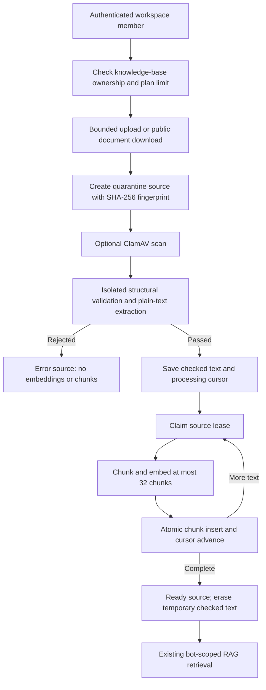

# Secure document uploads and public document links

## Enable the feature

Apply `supabase/106_secure_knowledge_documents.sql` after migration 105. It is safe to rerun. Restart the application after updating dependencies/configuration.

If a PDF already passed quarantine but failed during indexing, re-run the corrected migration 106 and use **Retry** on its source. The original version of the commit function assumed a `chunks.client_id` column that is absent from the product's canonical and deployed chunk schema. Ownership is derived through `chunks.dataset_id → datasets.client_id`; the corrected function keeps that ownership model. The migration also repeats the dataset-only context-nullability repair from migration 031. Checked text is retained after indexing failure, so a source that passed its security checks can resume without uploading the PDF again. Migration 105 contains the same column correction for website imports.

The main dashboard now has:

- New Knowledge Base → Add Sources → Upload documents.
- Knowledge Base → Sources → Add Source → Upload Documents.
- Document Link for publicly accessible Google Docs/Sheets, Drive files, PDF/DOCX/TXT/Markdown/CSV links, and static public HTML pages.

Files enter the same dataset/chunks tables used by the existing RAG retriever. Bot knowledge-base assignments continue to determine which bots can use them.

Use **Master Admin → Account 360 → Entitlements → Knowledge document size limit (MB)** for a client override, or publish a plan version with that allowance. Defaults are **5 MB per file**. Values from **0 to 20 MB** are supported; zero disables imports. The browser displays the effective limit, and both the server and SQL function enforce it. A client cannot raise the limit by changing a request.

The browser can select up to ten documents and uploads them sequentially. Each HTTP upload contains one file. Reverse proxies and hosting request-body limits must permit the chosen size plus multipart overhead. Platforms with a fixed lower request-body cap need a private direct-to-storage upload adapter before larger configured values can work there; changing the SaaS allowance cannot raise a provider's transport cap.

## Link extraction

The old route sent all links to Jina Reader and reported every provider failure as a document-sharing problem. It also ignored the existing Google export helper.

Google Docs now uses the public text export URL. Sheets uses CSV export and preserves the selected `gid`. Account-specific `/u/0/` links and published Google document links are recognized. Public Drive download links are converted to a download endpoint. Private files are not bypassed: Google authentication/access responses explain that public viewing/download permission or an exported upload is needed.

Downloads:

1. Require HTTPS and reject embedded credentials and local/private network addresses.
2. Revalidate and pin DNS for every redirect.
3. Follow at most three public redirects, including Google's export-to-googleusercontent redirects.
4. Forward no credentials across origins. Existing credentialed integrations retain their same-origin redirect restriction.
5. Enforce the workspace byte limit while streaming, with a 20-second deadline.
6. Detect document type and pass bytes through quarantine before extracting/indexing.

Sign-in HTML is rejected instead of being indexed as document text. Static HTML pages are converted to plain text with scripts, styles, navigation, and embedded markup removed. JavaScript-rendered pages without readable HTML require an exported file or the website importer. Google sharing and download restrictions remain authoritative; no Google OAuth account access is implied.

## Quarantine and parser restrictions

The file extension allowlist is PDF, TXT, DOCX, MD, and CSV. The MIME header alone is never trusted. A source starts as `pending` with `scan_status=quarantine`. Raw bytes remain in request memory; originals are neither publicly served nor written to a file-storage bucket.

Admission checks include:

- Size and filename checks, including path/control-character rejection.
- Actual PDF/ZIP signatures and strict text decoding.
- Executable headers and the EICAR test signature.
- PDF JavaScript, launch/open actions, embedded files, rich media, XFA/forms, and encryption rejection, including encoded PDF names and inspected Flate streams.
- DOCX macro/embedded executable rejection, archive path validation, archive member/expansion limits, external resource restrictions, and unsafe XML/field checks.
- A 20 MiB expansion cap, at most 256 DOCX archive entries, 150 PDF pages, 250,000 extracted characters, and XML complexity limits.

Binary parsing happens in a fresh child process with:

- 64 MiB old-generation V8 heap plus an 8 MiB young-generation setting. This limits V8 heap, not total process RSS.
- A 12-second wall-clock deadline and forced termination after completion/failure.
- Dynamic code generation disabled.
- Node permissions that allow reading only the parser, package metadata, and dependencies. Application configuration files, arbitrary filesystem reads/writes, child process spawning, and addons/workers are not allowed by this permission profile.
- No inherited application environment, database tokens, provider keys, or `NODE_OPTIONS`.

One request import slot per application process prevents parallel uploads from retaining unbounded buffers or launching unlimited parsers. A busy process returns a retryable response instead of building an in-memory queue. Request bytes are bounded before multipart parsing, with a 15-second upload deadline and a chunk-count ceiling.

Structural checks are **not a full antivirus engine or a guarantee against every exploit**. Node's permission model is an additional boundary, not a replacement for operating-system/container hardening. For an actual malware signature engine, configure a trusted private ClamAV service:

```ini
CLAMAV_HOST=your-private-scanner-host
CLAMAV_PORT=3310
```

The application uses ClamAV INSTREAM with a bounded timeout. When configured, positive detections, scanner errors, and scanner outages all reject the import. Do not expose ClamAV's unauthenticated TCP service publicly. Without this configuration, structural quarantine remains active and the status never claims a full antivirus scan.

The existing PDF library receives a copied Uint8Array to avoid its pooled-Buffer offset bug. DOCX extraction uses explicitly typed XML parsing of validated Word text parts; it does not render HTML or invoke the existing Mammoth/XML API combination that failed at runtime after the XML security upgrade. Headers/footers/footnotes are included as plain text. Images are not OCR'd, so scanned PDFs need OCR/export before importing.

## Chunking and RAG ingestion



Text chunks target 1,600 characters with 200-character overlap. Shared `gemini-embedding-001` embeddings use the existing 768-dimensional vector columns. The first batch is processed during import; remaining batches resume through the open knowledge-base page or the authenticated `/api/cron/knowledge-crawls` worker configured previously.

`knowledge_start_document` locks the workspace account and checks the current plan, dataset ownership, file bytes, and SHA-256 fingerprint. Identical successful/in-progress documents in the same knowledge base reuse the source. Rejected/error sources can be uploaded again. Duplicate responses do not claim newly added chunks.

Only sources with `scan_status=passed` can acquire an embedding lease. `knowledge_commit_document` validates the lease token and cursor, inserts chunks, advances progress, and updates dataset counters in one transaction. Deleted sources and stale workers cannot commit. Checked text remains available for retry after an embedding interruption; completed imports remove that temporary text. Existing source/chunk deletion applies to these imports as well.

The compatibility `/api/upload` and `/api/knowledge/upload` routes delegate to the same secure handler. Legacy workspace-context imports use a tenant-owned dataset and retain context association in their stored chunks.

## Runtime and operational considerations

All new work is on the ingestion path. Chat messages do not launch parsers or add document-scan requests. No permanent parser process or antivirus daemon is launched by the app. ClamAV is optional external infrastructure and should be sized separately if enabled.

Existing configured provider credentials are still required for real embeddings. The import security pipeline runs locally, while Supabase migrations must be applied to the database actually used by that local application. The cron route uses the existing `CRON_SECRET`; outside configured hosting, keep the knowledge-base page open or schedule the endpoint yourself.

## Verification

`npm run test:documents` exercises actual isolated parsing of valid PDF/TXT/DOCX/MD/CSV fixtures, executable and EICAR rejection, encoded PDF script rejection, appended PDF content, DOCX macros, ZIP expansion attacks, XML entities/external resources, HTML stripping, Google exports, private-link errors, byte limits without Content-Length, authentication before body parsing, and rejection before embeddings. PGlite executes the migration twice and tests size limits, dataset ownership, duplicate fingerprints, quarantine gating, lease exclusion, stale commits, atomic storage, temporary-text cleanup, disabled uploads, and service-role-only RPC permissions.

`npm run test:knowledge`, `npm run test:saas`, and `npm test` cover the existing crawl, tenant control-plane, and product behavior. Provider replies are mocked in offline tests; the PDF/DOCX/TXT/MD/CSV parser fixtures and SQL execution are real. An individual customer's Google link and live embeddings require a live test with that link and the application's configured credentials.

Security reference: [OWASP File Upload Cheat Sheet](https://cheatsheetseries.owasp.org/cheatsheets/File_Upload_Cheat_Sheet.html).
